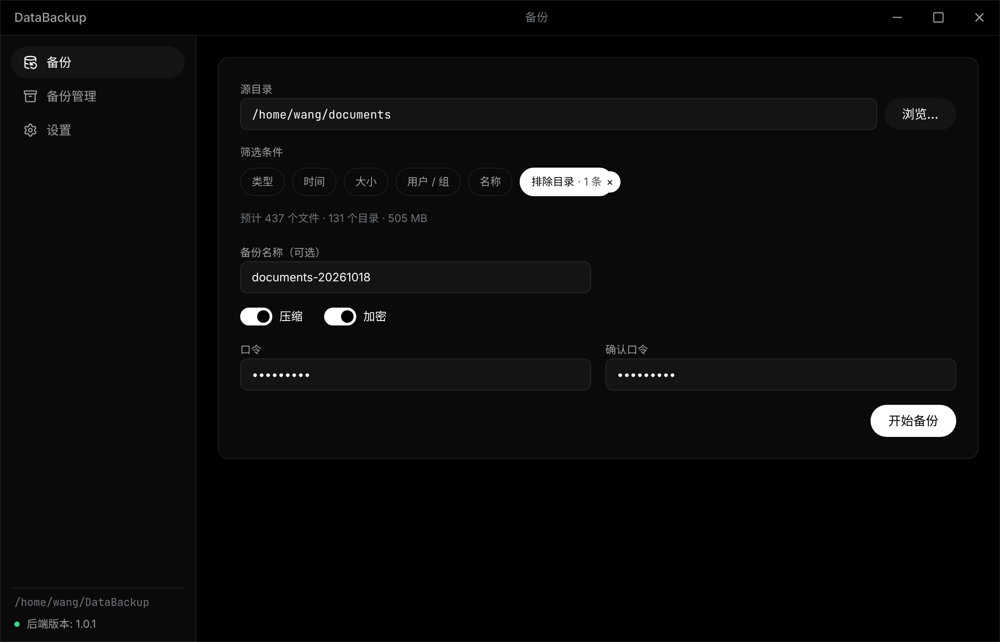
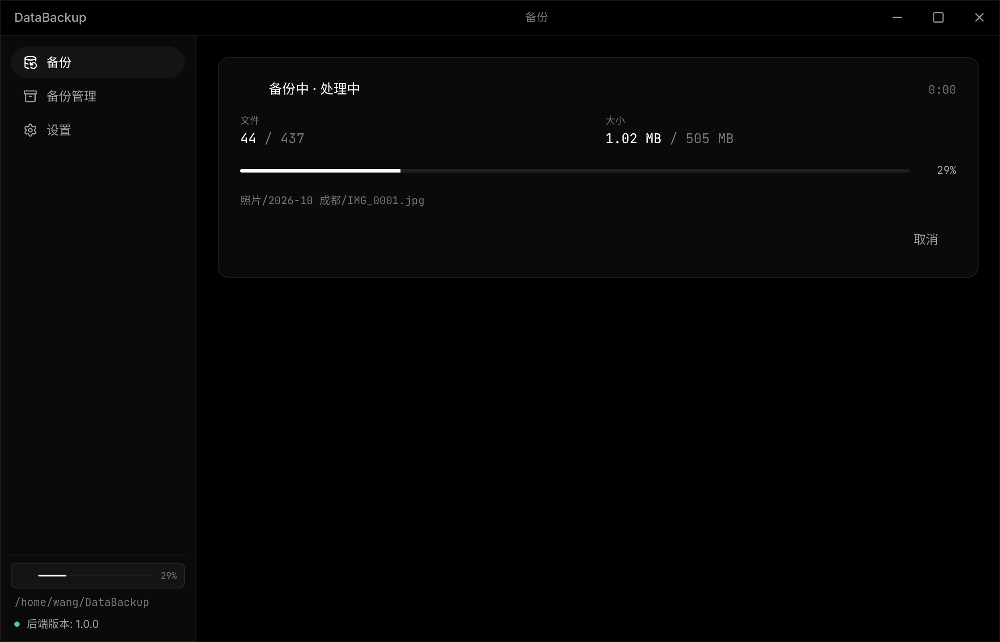
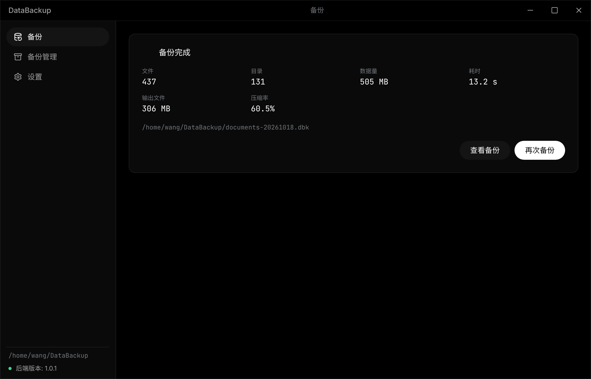
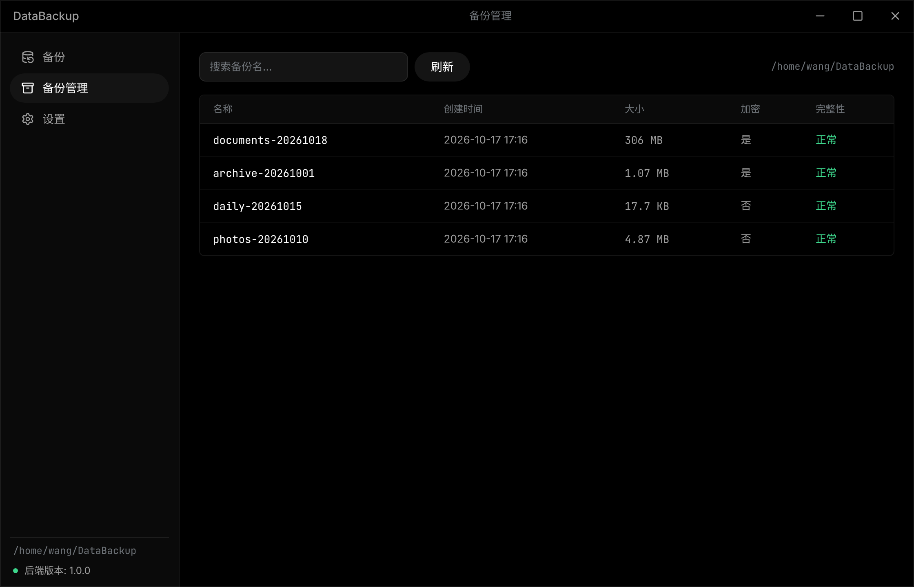
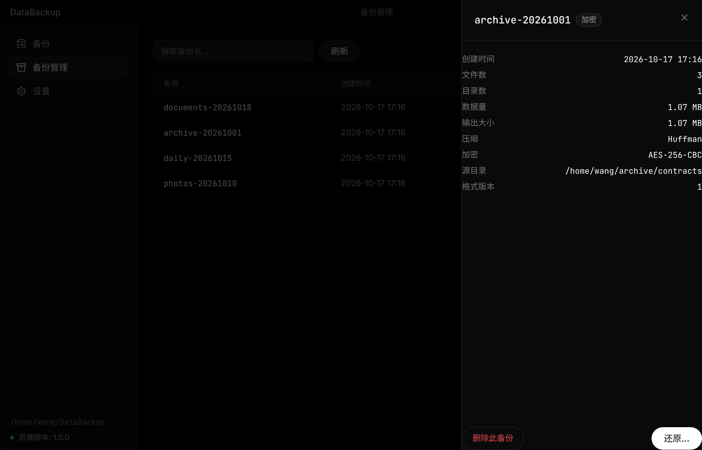
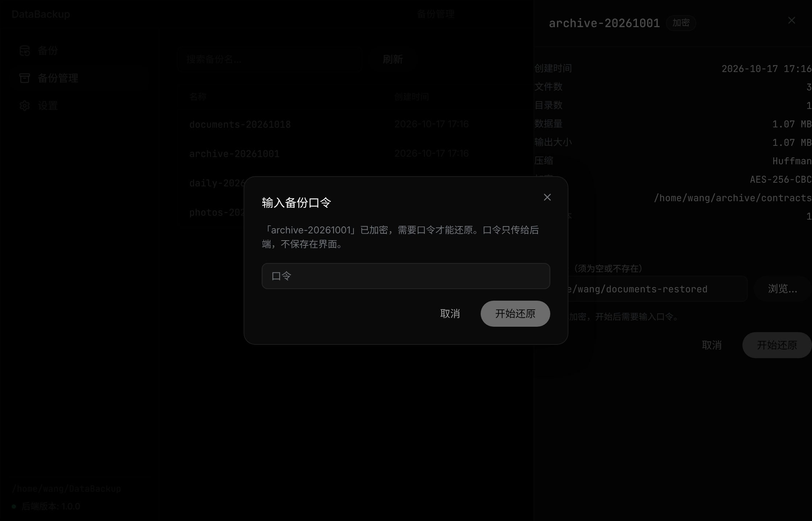
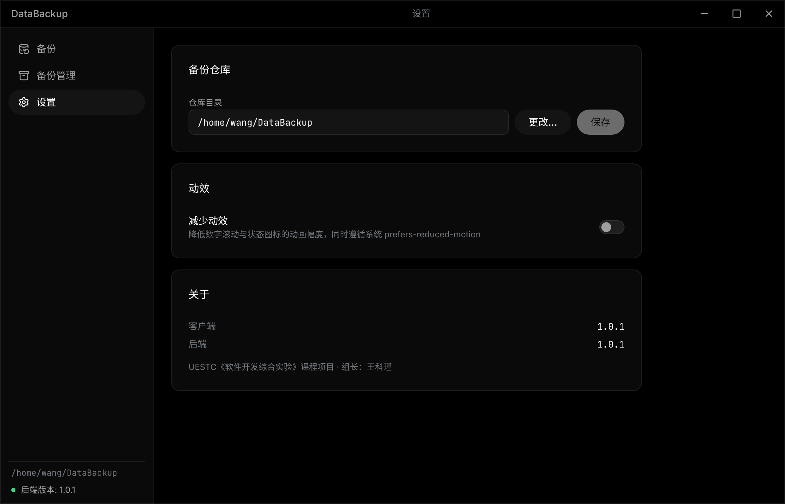

# DataBackup · 数据备份软件

电子科技大学《软件开发综合实验》课程项目。在 Linux 上把目录树备份成一个文件，并能原样还原——文件类型、权限属主时间、软硬链接都不丢；支持按路径/类型/名字/时间/尺寸/用户筛选，自研 MyPack 打包格式、Huffman 压缩与 AES-256 加密，配有 Electron 桌面客户端。

> **v1.0.1 已发布**（课程提交版）：产物（CLI 二进制 / AppImage / deb / 全部文档 PDF / sha256 校验）见 [Releases](https://github.com/Piaoxuemoli/software-class-qoobeewang/releases)。**演示视频已完成**（2:57.97，1920×1080/30fps，QC 全绿），制作与 QC 记录见 [docs/plans/video-qc.md](docs/plans/video-qc.md)。开发过程与任务追踪见 [docs/roadmap.md](docs/roadmap.md)。

## 功能（FR-01 ~ FR-18 全部实现）

| 功能 | 状态 | 说明 |
|---|---|---|
| 备份 / 还原目录树（FR-01、02） | ✅ | 单个 `.dbk` 文件；原子发布、取消无残留 |
| 特殊文件：软/硬链接、管道、设备、套接字（FR-03） | ✅ | 全部 7 种类型往返五要素一致 |
| 元数据：权限、属主、纳秒时间（FR-04） | ✅ | 含 setuid/setgid/sticky；目录元数据最后设置 |
| 自定义备份：路径/类型/名字/时间/尺寸/用户 六维过滤（FR-05~10） | ✅ | 可组合；32 组合 × 压缩 × 加密矩阵测试全过 |
| 打包解包：自研 MyPack（FR-11） | ✅ | 512 字节头记录仿 tar；拒绝路径穿越 |
| 压缩解压：自研 Huffman（FR-12） | ✅ | 1MiB 分块流式；512MB 文本压缩率 0.616 |
| 加密解密：自研 AES-256 + PBKDF2 + HMAC（FR-13） | ✅ | 全部手写，公开测试向量（FIPS-197 等）背书 |
| 备份管理与设置（FR-14、15） | ✅ | 列表 / 详情 / 删除 / 仓库路径配置 |
| Electron 图形客户端（FR-16） | ✅ | 三页面；口令仅经 stdin；真实后端端到端验证 |

质量：400+ 测试用例编号内嵌代码；核心包覆盖率 87%~100%；race 与 fuzz（488 万次执行）干净；staticcheck / go vet / ESLint 零告警。证据见[软件测试报告](docs/pdf/03-软件测试报告.pdf)。

## 界面

Electron 客户端，Grok 风格的纯黑单色界面，三页：备份 / 备份管理 / 设置。下面截图由 `client/e2e/capture-showcase.mjs` 驱动真实后端与真实备份仓库拍下（Ubuntu 24.04 + Xvfb，2× 像素）。



| 备份进行中 | 备份完成 |
|:--:|:--:|
|  |  |
| 阶段、文件与字节计数、当前路径；侧栏同步显示迷你进度 | 完成摘要：文件数、数据量、输出大小、压缩率与耗时 |

| 备份管理 | 备份详情 |
|:--:|:--:|
|  |  |
| 列表带加密与完整性标记；详情 Sheet 内发起还原或长按删除 | 容器头尾里的元信息，`list` / `info` 不需要口令即可查看 |

| 口令对话框 | 设置 |
|:--:|:--:|
|  |  |
| 加密备份还原时输入口令；口令只经 stdin 传给后端，不落盘、不进日志 | 仓库路径、减少动效与客户端/后端版本 |

截图基线怎么选、怎么评审，见 [docs/client/visual-regression.md](docs/client/visual-regression.md)。

## 演示视频（课程提交物 #4）

≤3 分钟的真实操作演示：真实 Electron 客户端 + 真实 Go 后端（v1.0.1），从"过滤 + 压缩 + 加密备份"到"管理 → 错误口令 → 正确还原 → `diff` 校验"全链路。成片 **2:57.97**，1920×1080 / 30 fps / H.264 + AAC，响度 −16.5 LUFS，QC 清单逐项通过。

| 项 | 说明 |
|---|---|
| 成片（本地，不入库） | `course/04-视频/DataBackup-demo-1.0.1.mp4`（视频/音频按规则不进版本库；上传平台由作者本人完成） |
| 制作文档 | [配音方案与试听](docs/plans/video-phase1.md) · [分镜固化与分段录制](docs/plans/video-phase2.md) · [合成与 QC 报告](docs/plans/video-qc.md) |
| 分镜/旁白/操作脚本 | [07-演示视频分镜与操作脚本](docs/deliverables/07-演示视频分镜与操作脚本.md) · [video-storyboard.json](docs/deliverables/video-storyboard.json) |
| 工具链 | `scripts/video/`（配音合成、语速测量、ASS 字幕/注解、整轨混音、ffmpeg 合成、QC）· `client/e2e/record-demo/`（Playwright 分段录制、页面内光标层、真实产物捕获） |
| 声音素材 | AISHELL-1（OpenSLR SLR33，Apache-2.0）说话人 S0101 男声；来源与许可见 `course/04-视频/voice/SOURCE.md`（本地） |

复现：`bash scripts/video/compose.sh all`（录制 → 字幕 → 混音 → QC 全链路脚本化，细节见 [video-qc.md](docs/plans/video-qc.md) §5）。

## 快速开始

### 1）直接使用发布产物

从 [Releases](https://github.com/Piaoxuemoli/software-class-qoobeewang/releases) 下载（Ubuntu 22.04/24.04）：

```bash
# CLI（独立二进制）
chmod +x databackup && ./databackup --help

# 桌面客户端（deb）
sudo dpkg -i databackup-client_1.0.1_amd64.deb && sudo apt-get -f install -y
/opt/DataBackup/databackup-client          # 或应用菜单里的 DataBackup

# 桌面客户端（AppImage，免安装）
chmod +x DataBackup-1.0.1.AppImage
./DataBackup-1.0.1.AppImage --appimage-extract-and-run   # 无 libfuse2 时
```

WSL2 + WSLg 的完整安装运行说明（含依赖、已知坑）见 [docs/client/wsl-guide.md](docs/client/wsl-guide.md)。

### 2）命令行示例

```bash
databackup backup  --source ~/docs --repo ~/backups --name daily \
                   --exclude-dir node_modules --compress huffman \
                   --encrypt aes256 --password-stdin
databackup restore --backup daily --repo ~/backups --target ~/docs.restored --password-stdin
databackup list --repo ~/backups --json
databackup backup --source ~/docs --dry-run     # 预览将备份哪些文件
```

协议（子命令、参数、JSON Lines 事件、错误码与退出码）见 [docs/architecture/cli-contract.md](docs/architecture/cli-contract.md)。

### 3）从源码构建

Windows 主机（Git Bash + Docker Desktop，无需安装 make/Go/Node）：

```bash
bash scripts/docker.sh check     # 在开发镜像里跑格式、lint、构建、测试
bash scripts/docker.sh shell     # 进入开发容器
```

Linux / 开发容器内：

```bash
bash scripts/install-deps.sh   # 首次：安装锁定版工具链（容器内已装好）
make check                     # 快速门禁
make package                   # 产出 AppImage / deb / CLI 到 dist/
make help                      # 全部目标
```

## 技术栈

- **后端**：Go 1.27（生产代码零第三方依赖，扩展功能全部自研，由 `scripts/check-imports.sh` 强制）
- **客户端**：Electron + React + TypeScript，经 CLI + JSON Lines 调用后端（逻辑全在后端）
- **工程**：Makefile、Docker 开发镜像、GitHub Actions CI / Release（tag 即发布）
- **文档**：Markdown + PlantUML，[docs/pdf/](docs/pdf/) 收录全部成品 PDF

## 文档索引

| 内容 | 位置 |
|---|---|
| 需求分析 / 系统设计 / 软件测试报告（PDF） | [docs/pdf/](docs/pdf/) |
| 答辩 PPT（pptx + PDF） | [docs/ppt/](docs/ppt/) · [docs/pdf/答辩PPT.pdf](docs/pdf/答辩PPT.pdf) |
| 客户端界面截图（README / PPT 用） | [docs/images/client/](docs/images/client/) |
| 演示视频脚本与录制清单 | [docs/deliverables/06-演示视频脚本.md](docs/deliverables/06-演示视频脚本.md) |
| 演示视频分镜与操作脚本 / 配音选型 | [07-演示视频分镜与操作脚本.md](docs/deliverables/07-演示视频分镜与操作脚本.md) · [AI 配音选型](docs/research/2026-10-18-AI配音选型.md) |
| 演示视频制作与 QC（P1 配音 / P2 录制 / P3 合成） | [video-phase1](docs/plans/video-phase1.md) · [video-phase2](docs/plans/video-phase2.md) · [video-qc](docs/plans/video-qc.md) |
| 架构 / MyPack / 容器格式 / CLI 协议 | [docs/architecture/](docs/architecture/) |
| 界面回归与截图基线规则 | [docs/client/visual-regression.md](docs/client/visual-regression.md) |
| WSL 安装运行指南 | [docs/client/wsl-guide.md](docs/client/wsl-guide.md) |
| **剩余人工任务清单（提交前必读）** | [docs/project/human-tasks.md](docs/project/human-tasks.md) |
| 测试规范与用例编号约定 | [docs/conventions/testing.md](docs/conventions/testing.md) |

## 目录

```
backend/   Go 后端（CLI + 核心库）   client/   Electron 客户端
docs/      项目文档与交付文档          scripts/  构建/lint/文档/发布脚本
docker/    开发与文档镜像             .github/  CI 与模板
```

## 参与开发

- 小组：组长王科瑾（单人组）。
- 本项目使用 AI 辅助开发：编码 agent 按 [AGENTS.md](AGENTS.md) 与 [docs/roadmap.md](docs/roadmap.md) 的并行任务设计工作，组长负责需求、设计决策与验收。
- 规范在 [docs/conventions/](docs/conventions/)。

## 许可

[MIT](LICENSE)
