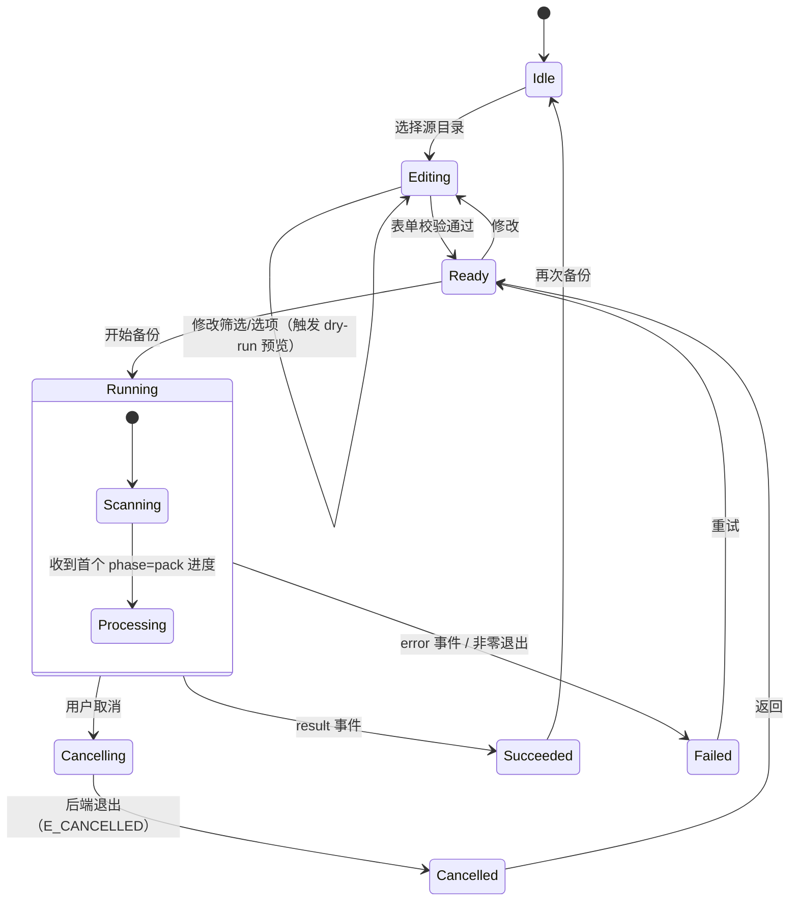
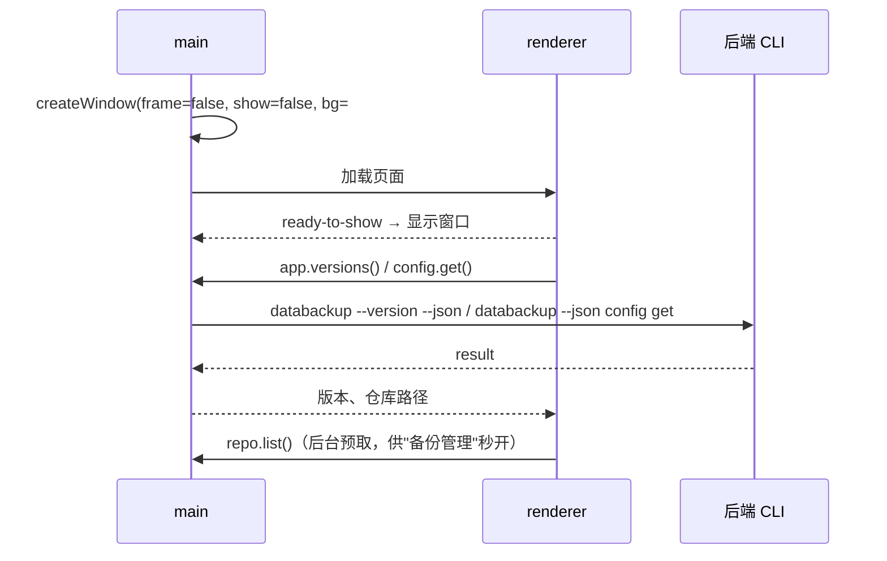
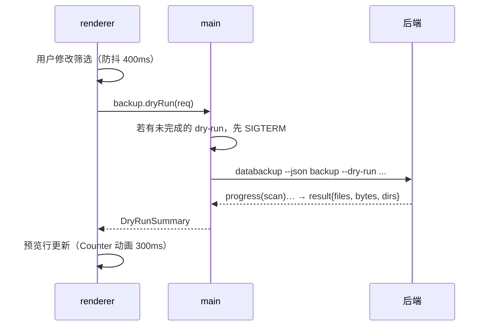
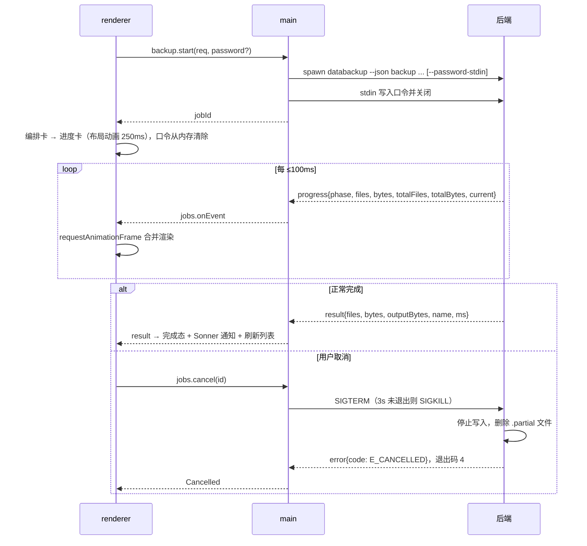
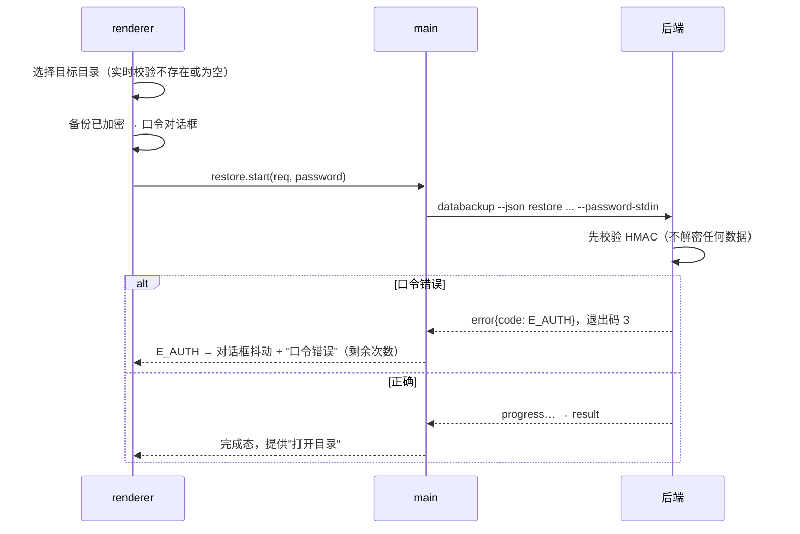

# 客户端交互与时序设计

> 视觉规范见 `ui-design.md`；后端协议见 `../architecture/cli-contract.md`。本文定义进程职责、IPC 接口、任务状态机、关键时序与时间约束。

## 1. 进程职责

| 进程 | 模块 | 职责 |
|---|---|---|
| main | `window.ts` | 创建无边框窗口；窗口控制（最小化/最大化/关闭）；最大化状态推送；关闭前若有任务运行则询问 |
| main | `backend/runner.ts` | 解析后端路径；`spawn`（不经 shell）；口令写入 stdin 后立即关闭 stdin；按行解析 JSONL；取消（SIGTERM，3s 后 SIGKILL） |
| main | `backend/jobs.ts` | 任务注册表：同一时刻只允许一个写类任务（backup/restore）；把事件按 jobId 转发给渲染进程 |
| main | `ipc/*.ts` | `ipcMain.handle` 处理器，入参用 zod 校验 |
| main | `dialogs.ts` | `showOpenDialog` 选目录 |
| preload | `index.ts` | `contextBridge` 暴露 `window.databackup`（见 §2），不暴露任何 Node 能力 |
| renderer | `stores/*` | zustand：`jobStore`（状态机）、`backupsStore`（列表缓存）、`settingsStore` |
| renderer | `pages/*`、`components/*` | 页面与组件，只依赖 store 和 `window.databackup` |

## 2. `window.databackup` 接口（类型放 `client/src/shared/`）

```ts
interface DataBackupApi {
  app: { versions(): Promise<{ client: string; backend: string }> };
  window: {
    minimize(): void; toggleMaximize(): void; close(): void;
    onMaximizedChange(cb: (maximized: boolean) => void): () => void;
  };
  dialog: { pickDirectory(opts?: { title?: string }): Promise<string | null> };
  backup: {
    dryRun(req: BackupRequest): Promise<DryRunSummary>;          // 可被下一次调用取消
    start(req: BackupRequest, password?: string): Promise<JobId>;
  };
  restore: { start(req: RestoreRequest, password?: string): Promise<JobId> };
  jobs: {
    cancel(id: JobId): Promise<void>;
    onEvent(id: JobId, cb: (e: BackendEvent) => void): () => void; // progress/log/result/error
  };
  repo: {
    list(): Promise<BackupInfo[]>; info(name: string): Promise<BackupInfo>;
    remove(name: string): Promise<void>;
  };
  config: { get(): Promise<Config>; set(patch: Partial<Config>): Promise<Config> };
}
```

`BackupRequest` 字段与 CLI 过滤参数一一对应；客户端只做"字段 → 参数"的纯函数转换（有单测），不做任何业务判断。

定稿（M1-3）类型：`client/src/shared/api.ts`（上面的接口与请求类型）、`client/src/shared/protocol.ts`（后端事件与结果，与 `cli-contract.md` 由契约测试锁定）。除 `window.*` 与 `jobs.onEvent` 外，方法失败时 reject 的 `Error.message` 为 `[<错误码>] <说明>`（`formatApiError` / `parseApiError`），因为 Error 跨 `contextBridge` 会丢失自定义属性。

## 3. 任务状态机（jobStore）



还原在 `Running` 之前多一个 `AwaitingPassword`（加密备份），收到 `E_AUTH` 回到 `AwaitingPassword` 并提示"口令错误"，连续 3 次失败后回到 `Ready`。

## 4. 关键时序

### 4.1 启动



后端不可用时：状态栏显示"后端不可用"，备份按钮禁用，并给出路径诊断信息。

### 4.2 过滤预览（dry-run）



### 4.3 备份（含取消）



### 4.4 还原加密备份（口令错误重试）



### 4.5 删除

按住"删除"按钮 1.2s 完成确认 → `repo.remove(name)` → 列表项退出动画 → Sonner 通知。

## 5. 时间与性能约束

| 项 | 约束 |
|---|---|
| 进度事件频率 | 后端节流：≤10 次/秒；最后一次必发 |
| 渲染合并 | 渲染进程用 `requestAnimationFrame` 合并同帧事件 |
| dry-run | 输入防抖 400ms；新请求取消旧请求；超过 2s 显示"计算中…" |
| 窗口按钮响应 | 立即（不等待任何异步） |
| 页面切换 | 150ms 淡入，不阻塞数据加载（先显示骨架） |
| 布局变形 | 编排卡 ↔ 进度卡 250ms |
| 减少动效 | 所有过渡降为 0ms 或纯透明度变化；WebGL 背景不渲染 |
| 并发 | 同时只允许一个备份/还原任务；`list/info/config/dry-run` 不受限 |
| 退出 | 有任务运行时关闭窗口需确认；确认后先取消任务，再退出 |

## 6. 错误映射

| `error.code` | 界面文案 | 建议操作 |
|---|---|---|
| `E_USAGE` | 参数有误：{message}（如正则非法、用户名不存在、时间区间颠倒；后端校验，客户端不重复实现） | 定位到对应筛选胶囊并修改 |
| `E_NOT_FOUND` | 源目录或备份不存在 | 重新选择 |
| `E_IO` | 读写失败：{message} | 检查权限/磁盘空间 |
| `E_TARGET_NOT_EMPTY` | 还原目录不为空 | 选择空目录或新目录 |
| `E_CORRUPT` | 备份文件已损坏 | 无法还原，可删除 |
| `E_EXISTS` | 同名备份已存在 | 修改备份名称 |
| `E_AUTH` | 口令错误或备份被篡改 | 重新输入口令 |
| `E_PASSWORD_REQUIRED` | 该备份已加密，需要口令 | 弹出口令对话框 |
| `E_CANCELLED` | 已取消 | — |
| `E_INTERNAL` | 内部错误：{message} | 显示详情并提示反馈 |
| `E_BUSY`（客户端） | 已有任务在运行 | 等待或取消当前任务 |
| `E_BACKEND_UNAVAILABLE`（客户端） | 后端不可用 | 显示路径诊断信息 |

## 7. 安全

- 口令只在内存中短暂存在：渲染进程提交后立即清空表单状态；main 写入 stdin 后丢弃引用；不写日志、不进崩溃报告。
- IPC 入参全部 zod 校验；路径参数在 main 侧再次规范化。
- `spawn` 参数数组传递，不拼接 shell 字符串。
