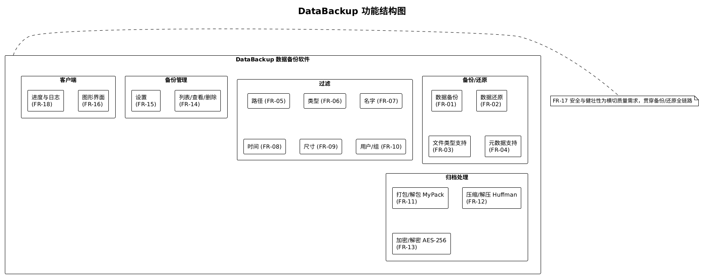
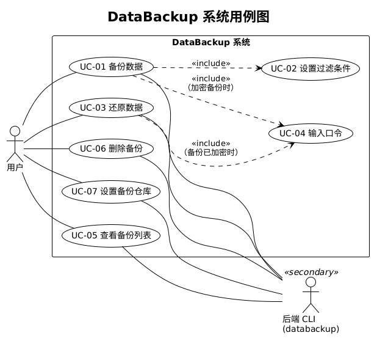

# 需求分析说明书

<!-- 负责任务：M1-1。结构严格按官方模板，不增删一级章节。需求编号沿用 docs/project/overview.md 的 FR-01~FR-18。 -->

## 1. 任务概述

### 1.1 引言

**编写目的**：本文档是 DataBackup 数据备份软件的需求规格说明，作为后续系统设计（《系统设计文档》）、编码实现与软件测试（《软件测试报告》）的基线。读者为本项目开发者（组长王科瑾）、课程评审教师与答辩委员。

**术语**：

| 术语 | 含义 |
|---|---|
| 备份仓库（repo） | 存放备份文件（`.dbk`）的目录；系统不使用数据库，仓库状态由扫描 `.dbk` 文件头得出 |
| MyPack | 本项目自研的归档格式（仿 tar：512 字节头记录 + 数据块） |
| JSONL / JSON Lines | 后端 `--json` 模式下在 stdout 上逐行输出 JSON 事件的协议 |
| 哨兵错误 | Go 中用于 `errors.Is` 判别的包级错误值，CLI 据此映射为错误码与退出码 |
| FR-xx | 功能需求编号，与《项目简介》（`../project/overview.md`）§3 一致 |
| UC-xx | 用例编号，见 §2.2 |
| 契约 | `../architecture/cli-contract.md`，后端 CLI/JSONL 协议的唯一来源（已冻结） |

**参考资料**：课程任务书（`../project/course-requirements.md`）、项目简介（`../project/overview.md`）、架构设计（`../architecture/overview.md`）、CLI 协议（`../architecture/cli-contract.md`）。

### 1.2 综合描述

#### 1.2.1 产品的状况

DataBackup 是新型、自主开发的单机 Linux 数据备份工具，由两部分组成：

- **后端**：Go 编写的命令行程序 `databackup`，负责备份、还原、过滤、打包、压缩、加密、备份管理与配置，仅以标准库实现（自研 MyPack 归档、Huffman 压缩、SHA-256/HMAC/PBKDF2/AES-256-CBC 加密）。
- **客户端**：Electron + React 桌面程序，通过 spawn 子进程调用后端 CLI 并以 JSON Lines 协议接收进度与结果，提供"备份 / 管理备份数据 / 设置"三个页面。

产品不依赖网络、数据库与第三方运行时，可完全离线运行。

#### 1.2.2 产品的功能

| 编号 | 功能 | 说明 |
|---|---|---|
| FR-01 | 数据备份 | 将源目录树备份为一个 `.dbk` 备份文件，存入备份仓库 |
| FR-02 | 数据还原 | 将备份文件还原到指定（不存在的或空的）目录 |
| FR-03 | 文件类型支持 | 普通文件、目录、软链接、硬链接、FIFO、字符设备、块设备、套接字 |
| FR-04 | 元数据支持 | 权限位、属主/属组（uid/gid）、访问/修改时间，还原时恢复 |
| FR-05 | 过滤：路径 | 选择源目录，排除指定子目录 |
| FR-06 | 过滤：类型 | 按文件类型（`f d l c b s p`）筛选 |
| FR-07 | 过滤：名字 | 按正则（RE2）排除文件名 |
| FR-08 | 过滤：时间 | 按修改时间 / 创建（状态变更）时间闭区间筛选 |
| FR-09 | 过滤：尺寸 | 按文件大小闭区间筛选（仅普通文件） |
| FR-10 | 过滤：用户/组 | 排除指定属主或属组的文件 |
| FR-11 | 打包/解包 | 自研 MyPack 归档格式 |
| FR-12 | 压缩/解压 | 自研规范 Huffman 编码（分块流式） |
| FR-13 | 加密/解密 | 口令 → PBKDF2-HMAC-SHA256 → AES-256-CBC + HMAC 校验（全部手写） |
| FR-14 | 备份管理 | 列出、查看、删除仓库中的备份 |
| FR-15 | 设置 | 配置备份仓库路径等 |
| FR-16 | 图形客户端 | Electron 客户端三个页面 |
| FR-17 | 安全与健壮性 | 完整性校验、错误口令识别、目标目录须为空、拒绝路径穿越、错误输入友好提示 |
| FR-18 | 进度与日志 | 后端 JSONL 输出进度/日志/结果，客户端实时展示 |

过滤、还原与错误处理的精确语义以已冻结的 `../architecture/cli-contract.md` §2、§4 为准，本文不另行定义。

#### 1.2.3 用户类和特性

| 用户类 | 特征 | 主要使用方式 |
|---|---|---|
| 普通桌面用户 | 需要备份个人目录（文档、照片等），不一定熟悉命令行 | Electron 客户端三页操作 |
| 进阶/运维用户 | 熟悉 shell，可能将备份纳入脚本 | 直接调用 `databackup` CLI（`--json` 输出供程序消费） |

两类用户共用同一个后端，功能与语义完全一致。

### 1.3 运行环境

#### 1.3.1 基本配置

（1）硬件平台：x86-64 个人计算机。

（2）操作系统：Linux（目标发行版 Ubuntu 22.04 / 24.04）；演示环境可为 WSL2 Ubuntu（WSLg 显示 Electron 窗口）。

#### 1.3.2 其他配置

（1）内存：≥ 512 MB（后端流式处理，内存占用与文件总量无关）。

（2）硬盘：除系统占用外，需要与备份数据量相当的空闲空间存放 `.dbk` 文件。

（3）网络：不需要。

## 2. 功能需求

### 2.1 功能划分

（源文件 `diagrams/function-structure.puml`。）功能按"备份/还原、过滤、归档处理、备份管理、客户端"五组划分；FR-17（安全与健壮性）为横切质量需求，体现在各组的校验与错误处理中。

### 2.2 系统用例

系统用例总图如下（各用例小节的用例图均为该图对应部分）：

（源文件 `diagrams/use-cases.puml`。）

#### 2.2.1 用例编号 UC-01

##### 2.2.1.1 用例图

见系统用例总图：UC-01 备份数据（include UC-02；加密时 include UC-04）。

##### 2.2.1.2 用例描述

| 字段 | 内容 |
|---|---|
| 用例标识 | UC-01 |
| 用例名称 | 备份数据 |
| 创建人 | 王科瑾 |
| 创建日期 | 2026-10-16 |
| 语境目标 | 将源目录树按选定条件备份为仓库中的一个 `.dbk` 文件（FR-01、03、04、11、12、13、17、18） |
| 前置条件 | 源目录存在且为目录；备份名合法（1~200 字节、不含 `/` 与 NUL、不以 `.` 开头）且不重名 |
| 成功的结束状态 | 仓库中新增 `<name>.dbk`；输出结果含文件/目录数、原始与输出字节数、警告数 |
| 失败的结束状态 | 不产出 `.dbk`（`.partial` 已删除）；输出对应错误码的 `error` 事件或 stderr 诊断 |
| 参与者 | 用户（经客户端或 CLI）、后端 `databackup` |
| 触发器 | 用户在"备份"页点击"开始备份"，或执行 `databackup backup` |
| 基础用例 | 无 |
| 包含用例 | UC-02（设置过滤条件）；选择 AES-256 加密时 UC-04（输入口令） |
| 扩展用例 | 预览（`--dry-run`）：只扫描统计、不写文件、不读口令 |
| 事件流 | 基本流程：1) 用户选择源目录与可选参数（名字、压缩、加密、过滤条件）；2) 系统校验参数（非法 → E_USAGE）；3) 用户确认开始；4) 系统先扫描（scan 阶段进度事件）再打包写出 `.partial`（pack 阶段进度事件）；5) 成功后原子改名为 `.dbk` 并输出结果事件。扩展流程：2a 参数非法 → 输出 E_USAGE、退出码 2；2b 源目录不存在 → E_NOT_FOUND、退出码 1；4a 同名备份已存在 → E_EXISTS；4b 用户取消 → 删除 `.partial`、E_CANCELLED、退出码 4；4c IO/校验错误 → 删除 `.partial`、输出 E_IO/E_CORRUPT 等；4d 其他未分类的内部错误 → 删除 `.partial`、E_INTERNAL、退出码 1；4e 某些项无法读取（权限不足等）→ 输出 warn 并跳过、计入 `warnings`，备份继续 |
| 非功能需求 | 流式处理，不整体读入内存；进度事件每阶段 ≤10 次/秒且阶段结束必发一次（FR-18） |
| 补充规格说明书 | 参数、过滤语义、事件字段与错误码详见 `../architecture/cli-contract.md` §2.1、§3、§4 |

#### 2.2.2 用例编号 UC-02

##### 2.2.2.1 用例图

见系统用例总图：UC-02 设置过滤条件（被 UC-01 include）。

##### 2.2.2.2 用例描述

| 字段 | 内容 |
|---|---|
| 用例标识 | UC-02 |
| 用例名称 | 设置过滤条件 |
| 创建人 | 王科瑾 |
| 创建日期 | 2026-10-16 |
| 语境目标 | 限定备份范围：类型、排除子目录、排除名字正则、时间区间、尺寸区间、排除属主/属组（FR-05~10） |
| 前置条件 | 处于备份参数编辑中 |
| 成功的结束状态 | 过滤条件被接受并用于本次备份/预览 |
| 失败的结束状态 | 非法条件被拒，提示 E_USAGE |
| 参与者 | 用户 |
| 触发器 | 用户在备份表单填写过滤项，或在命令行给出 `--types` 等参数 |
| 基础用例 | UC-01 |
| 包含用例 | 无 |
| 扩展用例 | 无 |
| 事件流 | 基本流程：1) 用户勾选类型集合 `f d l c b s p`（空集合=全部）；2) 添加排除子目录（可多条，相对源目录或源内绝对路径）；3) 添加排除文件名正则（RE2，只匹配 `path.Base`）；4) 设置修改/创建时间闭区间（缺省不限，只写日期时 from 取 00:00:00、to 取 23:59:59.999999999 本地时区）；5) 设置尺寸闭区间（仅作用于普通文件）；6) 添加排除属主/属组（名称或数字 ID）。扩展流程：任一正则非法、区间反向、用户名/组名不存在 → E_USAGE。目录只受类型与排除目录约束（名字/时间/尺寸/用户组不作用于目录）；排除目录命中即整棵跳过。附加规则（契约 §2.1）：a) 源目录本身不进入归档，归档只含其下内容，路径一律相对源目录；b) 仓库目录若位于源目录内，自动排除；c) 硬链接只在被保留的条目之间识别——同一 inode 第一次被备份时存数据，之后的路径记为指向它的硬链接，被过滤掉的路径不参与识别；d) 无法读取的项（权限不足等）输出 warn 并跳过、计入 `warnings`，不使备份失败 |
| 非功能需求 | 校验在参数解析与 `filter.New` 两级完成，尽早报 E_USAGE |
| 补充规格说明书 | 过滤语义以 `../architecture/cli-contract.md` §2.1"过滤语义"为准 |

#### 2.2.3 用例编号 UC-03

##### 2.2.3.1 用例图

见系统用例总图：UC-03 还原数据（备份已加密时 include UC-04）。

##### 2.2.3.2 用例描述

| 字段 | 内容 |
|---|---|
| 用例标识 | UC-03 |
| 用例名称 | 还原数据 |
| 创建人 | 王科瑾 |
| 创建日期 | 2026-10-16 |
| 语境目标 | 将 `.dbk` 备份还原为目录树，恢复文件类型与元数据（FR-02、03、04、11、12、13、17、18） |
| 前置条件 | 备份文件存在；目标目录不存在或为空 |
| 成功的结束状态 | 目标目录中重建出与备份一致的目录树（类型、权限、属主、时间戳） |
| 失败的结束状态 | 目标目录可能不完整（取消不回滚，发 warn 说明）；输出错误事件 |
| 参与者 | 用户（经客户端或 CLI）、后端 `databackup` |
| 触发器 | 用户在"管理备份数据"页选择备份点"还原"，或执行 `databackup restore` |
| 基础用例 | 无 |
| 包含用例 | 备份已加密时 UC-04（输入口令） |
| 扩展用例 | 无 |
| 事件流 | 基本流程：1) 用户选择备份（名称或 `.dbk` 路径）与目标目录；2) 系统解析备份位置（不存在 → E_NOT_FOUND）；3) 检查目标目录（已存在且非空或不是目录 → E_TARGET_NOT_EMPTY、退出码 1）；4) 写任何文件前完整校验备份（损坏 → E_CORRUPT；加密未给口令 → E_PASSWORD_REQUIRED、退出码 3；口令错误/被篡改 → E_AUTH、退出码 3）；5) 逐条重建文件并报告进度（restore 阶段）；6) 输出结果。扩展流程：5a 容器内条目含 `..`/绝对路径 → 拒绝、E_CORRUPT（路径穿越防护，FR-17）；5b 非 root 用户 → 跳过属主恢复并输出 warn，不视为失败；无法创建的字符/块设备同样 warn 后跳过（计入 warnings、不计入 files）；5c 用户取消 → 不回滚、warn 提示目标不完整、E_CANCELLED、退出码 4；5d 其他未分类的内部错误 → E_INTERNAL、退出码 1 |
| 非功能需求 | 还原先完整校验再写文件；目录元数据最后设置 |
| 补充规格说明书 | 还原与错误语义以 `../architecture/cli-contract.md` §2.2、§4 为准 |

#### 2.2.4 用例编号 UC-04

##### 2.2.4.1 用例图

见系统用例总图：UC-04 输入口令（被 UC-01/UC-03 include）。

##### 2.2.4.2 用例描述

| 字段 | 内容 |
|---|---|
| 用例标识 | UC-04 |
| 用例名称 | 输入口令 |
| 创建人 | 王科瑾 |
| 创建日期 | 2026-10-16 |
| 语境目标 | 为加密备份提供/验证口令（FR-13、17） |
| 前置条件 | 操作对象需要口令：备份选择 `--encrypt aes256`，或还原的备份已加密 |
| 成功的结束状态 | 口令被后端接受（备份）或校验通过（还原） |
| 失败的结束状态 | 口令为空或超 1024 字节 → E_USAGE；还原时口令错误 → E_AUTH；客户端连续 3 次失败后停止重试、返回就绪态（对话框提示剩余次数） |
| 参与者 | 用户 |
| 触发器 | 用户勾选加密 / 还原加密备份；命令行为 `--password-stdin` 从 stdin 读入 |
| 基础用例 | UC-01、UC-03 |
| 包含用例 | 无 |
| 扩展用例 | 无 |
| 事件流 | 基本流程：1) 客户端弹出口令输入框（不回显）或在脚本中经 stdin 提供；2) 口令经 stdin 传给后端，读到首个 `\n` 或 EOF 为止、去结尾 `\r`，长度 1~1024 字节；3) 后端用于 PBKDF2 派生密钥，不记录、不回显、不出现在命令行参数/环境变量/日志中。扩展流程：口令为空或超长 → E_USAGE；`--encrypt aes256` 与 `--password-stdin` 未配套 → E_USAGE；还原口令错误 → 客户端回到口令对话框并提示剩余次数，连续 3 次失败后回到就绪态（`../client/interaction.md` §3） |
| 非功能需求 | 口令只允许经 stdin 传递（FR-17）；客户端不持久化口令 |
| 补充规格说明书 | 口令输入规则见 `../architecture/cli-contract.md` §1"约定" |

#### 2.2.5 用例编号 UC-05

##### 2.2.5.1 用例图

见系统用例总图：UC-05 查看备份列表。

##### 2.2.5.2 用例描述

| 字段 | 内容 |
|---|---|
| 用例标识 | UC-05 |
| 用例名称 | 查看备份列表 |
| 创建人 | 王科瑾 |
| 创建日期 | 2026-10-16 |
| 语境目标 | 列出仓库中的全部备份并查看单个备份详情（FR-14） |
| 前置条件 | 已确定仓库目录（`--repo` → 配置文件 → `~/DataBackup`） |
| 成功的结束状态 | 按创建时间降序、名字升序列出 `.dbk` 备份；可查看单个备份的头/尾信息 |
| 失败的结束状态 | 仓库不可读等 → E_IO；查看不存在/损坏的备份 → E_NOT_FOUND/E_CORRUPT |
| 参与者 | 用户（经客户端或 CLI）、后端 `databackup` |
| 触发器 | 打开"管理备份数据"页，或执行 `databackup list` / `databackup info` |
| 基础用例 | 无 |
| 包含用例 | 无 |
| 扩展用例 | 无 |
| 事件流 | 基本流程：1) 用户打开管理页（客户端周期性调用 `list`）；2) 系统扫描仓库 `.dbk` 并读取容器头尾（无数据库）；3) 损坏文件以 `corrupt=true` 列出；4) 用户选中某备份查看详情（`info`）：名字、大小、创建时间、来源目录、文件/目录/字节数、是否压缩/加密、格式版本 |
| 非功能需求 | 列出操作只读头尾元数据，不加载负载 |
| 补充规格说明书 | `list`/`info` 字段与排序见 `../architecture/cli-contract.md` §3 |

#### 2.2.6 用例编号 UC-06

##### 2.2.6.1 用例图

见系统用例总图：UC-06 删除备份。

##### 2.2.6.2 用例描述

| 字段 | 内容 |
|---|---|
| 用例标识 | UC-06 |
| 用例名称 | 删除备份 |
| 创建人 | 王科瑾 |
| 创建日期 | 2026-10-16 |
| 语境目标 | 删除仓库中的一个 `.dbk` 备份（FR-14） |
| 前置条件 | 备份存在 |
| 成功的结束状态 | 该 `.dbk` 文件被删除 |
| 失败的结束状态 | 备份不存在 → E_NOT_FOUND；显式路径不是 `.dbk` → E_USAGE |
| 参与者 | 用户（经客户端或 CLI）、后端 `databackup` |
| 触发器 | 用户在管理页对某备份点"删除"（客户端先弹确认），或执行 `databackup delete` |
| 基础用例 | 无 |
| 包含用例 | 无 |
| 扩展用例 | 无 |
| 事件流 | 基本流程：1) 用户选择备份（名称或 `.dbk` 路径）；2) 客户端弹出确认对话框；3) 系统删除文件并返回结果（只删除 `.dbk`，拒绝其他路径）；4) 列表刷新。扩展流程：备份不存在 → E_NOT_FOUND |
| 非功能需求 | 删除操作不可恢复，客户端必须二次确认 |
| 补充规格说明书 | 名称解析与只删 `.dbk` 的约束见 `../architecture/cli-contract.md` §2.2 |

#### 2.2.7 用例编号 UC-07

##### 2.2.7.1 用例图

见系统用例总图：UC-07 设置备份仓库。

##### 2.2.7.2 用例描述

| 字段 | 内容 |
|---|---|
| 用例标识 | UC-07 |
| 用例名称 | 设置备份仓库路径 |
| 创建人 | 王科瑾 |
| 创建日期 | 2026-10-16 |
| 语境目标 | 查看/修改备份仓库默认路径（FR-15） |
| 前置条件 | 无 |
| 成功的结束状态 | `config.json` 中原子更新 `repo`，后续备份/管理默认使用新路径 |
| 失败的结束状态 | 值为相对路径或未知 KEY → E_USAGE；写入失败 → E_IO |
| 参与者 | 用户（经客户端或 CLI）、后端 `databackup` |
| 触发器 | 用户在"设置"页修改仓库路径，或执行 `databackup config set repo <path>` |
| 基础用例 | 无 |
| 包含用例 | 无 |
| 扩展用例 | 无 |
| 事件流 | 基本流程：1) 用户打开设置页（`config get` 显示当前值）；2) 输入新的绝对路径；3) 系统校验（绝对路径；已存在必须是目录）；4) 经同目录临时文件原子写入 `$XDG_CONFIG_HOME/databackup/config.json`；5) 返回完整配置。扩展流程：相对路径/未知 KEY → E_USAGE |
| 非功能需求 | 并发写不产生损坏文件（原子改名） |
| 补充规格说明书 | 配置语义见 `../architecture/cli-contract.md` §2.2 `config` 命令 |

#### 2.2.8 功能需求与用例追溯矩阵

● 表示该用例直接实现该需求；○ 表示经 include 关系或作为横切约束涉及该需求。

| 需求 | UC-01 备份 | UC-02 过滤 | UC-03 还原 | UC-04 口令 | UC-05 列表 | UC-06 删除 | UC-07 设置 | 说明 |
|---|---|---|---|---|---|---|---|---|
| FR-01 数据备份 | ● | | | | | | | |
| FR-02 数据还原 | | | ● | | | | | |
| FR-03 文件类型支持 | ● | | ● | | | | | 打包与重建全部 7 种类型及硬链接 |
| FR-04 元数据支持 | ● | | ● | | | | | 备份时采集，还原时恢复 |
| FR-05 过滤：路径 | ○ | ● | | | | | | UC-01 include UC-02 |
| FR-06 过滤：类型 | ○ | ● | | | | | | 同上 |
| FR-07 过滤：名字 | ○ | ● | | | | | | 同上 |
| FR-08 过滤：时间 | ○ | ● | | | | | | 同上 |
| FR-09 过滤：尺寸 | ○ | ● | | | | | | 同上 |
| FR-10 过滤：用户/组 | ○ | ● | | | | | | 同上 |
| FR-11 打包/解包 | ● | | ● | | | | | 备份打包、还原解包 |
| FR-12 压缩/解压 | ● | | ● | | | | | 备份压缩、还原解压 |
| FR-13 加密/解密 | ● | | ● | ● | | | | 口令经 UC-04 提供 |
| FR-14 备份管理 | | | | | ● | ● | | 列出/查看、删除 |
| FR-15 设置 | | | | | | | ● | |
| FR-16 图形客户端 | ● | ● | ● | ● | ● | ● | ● | 每个用例都可经客户端三页触发 |
| FR-17 安全与健壮性 | ● | ○ | ● | ● | ○ | ○ | ○ | `.partial` 原子改名、HMAC 校验、目标须为空、拒绝路径穿越、只删 `.dbk`、配置原子写、非法输入报 E_USAGE |
| FR-18 进度与日志 | ● | | ● | | | | | scan/pack/restore 阶段进度与 warn 日志 |

每个 FR 至少被一个用例覆盖，每个用例至少承载一个 FR；测试用例（TC）与 FR 的追溯见《软件测试报告》。

## 3. 外部接口需求

### 3.1 用户界面

- **Electron 客户端**（FR-16）：无边框自绘窗口 + 侧栏导航，三个页面——"备份"（源目录、名字、过滤、压缩、加密表单与进度）、"管理备份数据"（备份列表、详情、还原、删除）、"设置"（仓库路径等）。视觉规范见 `../client/ui-design.md`，交互与状态机见 `../client/interaction.md`。
- **命令行界面**：`databackup <子命令> [参数]`，子命令为 `backup/restore/list/info/delete/config`；`--help`、`--version`、`--json` 为全局参数。文本模式下诊断走 stderr；`--json` 模式下 stdout 只输出 JSON Lines 事件（progress/log/result/error）。

### 3.2 硬件接口

仅读写本地文件系统；块设备/字符设备仅在"作为备份内容被打包与还原"的意义上涉及（FR-03），不直接操作硬件。

### 3.3 软件接口

| 接口 | 说明 |
|---|---|
| Linux 文件系统 / 系统调用 | `lstat/mkfifo/mknod/lchown/link/symlink/utimes` 等，经 Go 标准库 `os`/`syscall` 使用（FR-03、04） |
| 客户端 ↔ 后端 | 客户端以 `spawn`（无 shell）调用 `databackup --json <子命令>`，stdout 逐行 JSON 事件，口令经 stdin；协议唯一来源为 `../architecture/cli-contract.md` |
| 错误码与退出码 | 失败时 stdout 最后一行为 `error` 事件（契约 §4）：退出码 1 —— `E_IO`、`E_NOT_FOUND`、`E_TARGET_NOT_EMPTY`、`E_CORRUPT`、`E_EXISTS`、`E_INTERNAL`（未分类的内部错误）；退出码 2 —— `E_USAGE`；退出码 3 —— `E_AUTH`、`E_PASSWORD_REQUIRED`；退出码 4 —— `E_CANCELLED`。客户端收到非零退出码却没有 `error` 事件时按退出码兜底映射（1 → `E_INTERNAL`，2 → `E_USAGE`，3 → `E_AUTH`，4 或被信号终止 → `E_CANCELLED`） |
| 配置文件 | `$XDG_CONFIG_HOME/databackup/config.json`（未设置时 `~/.config/...`），JSON，目前仅 `repo` 一项 |
| 备份仓库 | 目录下若干 `.dbk` 文件；无索引/数据库，列表由扫描容器头尾得出 |

## 4. 其它非功能性需求

### 4.1 性能需求

- 后端流式处理：任意文件以 `io.Reader/Writer` 串联，内存占用不随数据总量增长。
- 进度事件节流：每阶段 ≤10 次/秒，阶段结束必发一次（FR-18）。
- 大目录树（≥10 万项）备份/还原不出现内存性失败；具体吞吐指标在《软件测试报告》中以 Benchmark 证据给出。

### 4.2 安全性需求

- 口令只经 stdin 传递，不出现在命令行参数、环境变量、日志与持久化存储（FR-17）。
- 加密备份使用 PBKDF2-HMAC-SHA256（10 万轮）派生密钥、AES-256-CBC 加密、HMAC-SHA256 完整性校验（encrypt-then-MAC）；口令错误或数据被篡改报 E_AUTH（FR-13、17）。
- 还原拒绝归档内 `..` 与绝对路径条目（防路径穿越）；备份写 `.partial` 后原子改名，失败/取消不留半成品。
- Electron 保持 `contextIsolation: true`、`sandbox: true`、`nodeIntegration: false`。

### 4.3 软件质量属性

- **正确性**：备份→还原往返后目录树"五要素"（类型、内容、权限、属主、时间戳）一致，由测试夹具 `AssertTreeEqual` 验证；每类文件类型均有往返用例。
- **健壮性**：损坏/截断的 `.dbk`、错误口令、非空目标目录、非法参数均给出对应错误码而不崩溃；解码器对任意输入不 panic、不死循环（fuzz 覆盖）。
- **易用性**：用法错误统一 E_USAGE 并附用法文本；`--json` 输出可被程序稳定解析；客户端操作均有进度反馈与确认提示。
- **可维护性**：后端零第三方依赖、按包分层（walk→filter→pack→huffman→crypto→container→repo）；CLI 协议冻结并有双端契约测试。

## 5. 项目规划

### 5.1 人员分工

本项目为单人组：**组长王科瑾**承担项目经理、需求分析、系统设计、编码、测试全部角色，无组员。项目使用 AI 辅助开发：编码 agent 承担大部分编码、测试与文档起草，组长负责需求与方向、设计决策、验收与现场答辩。

### 5.2 项目总体规划

项目分波次并行推进（详见 `../roadmap.md` §1）：M0 基建 → M1 接口冻结与文档初稿 → M2~M6 后端各原语与集成 → C0~C3 客户端 → M7 打包 → M8 测试报告 → M9 文档定稿/答辩材料。进度计划见 `../project/schedule.md` 与甘特图 `../project/diagrams/schedule-gantt.png`（源文件 `schedule-gantt.puml`）。
