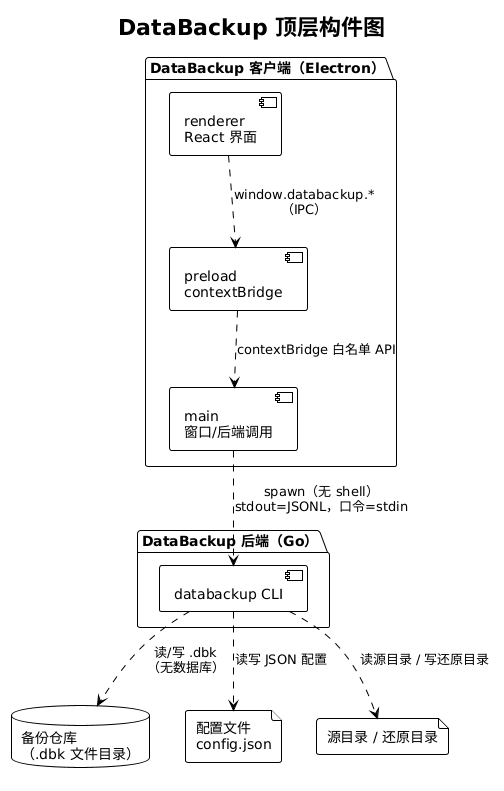
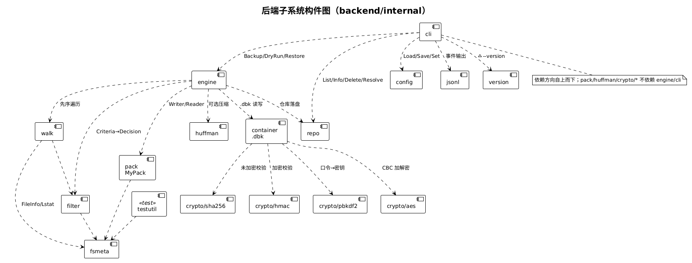
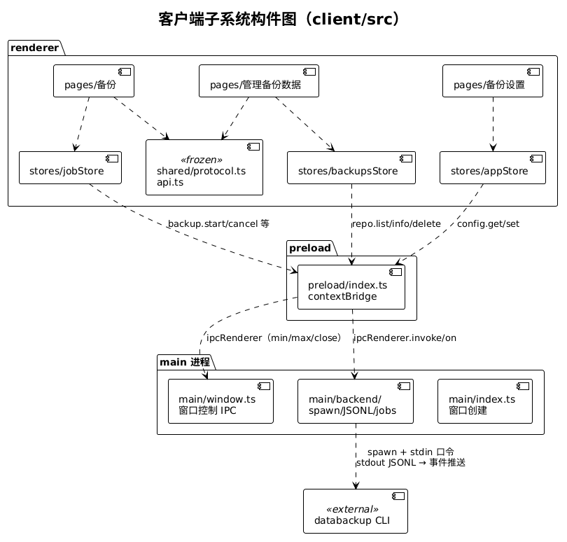
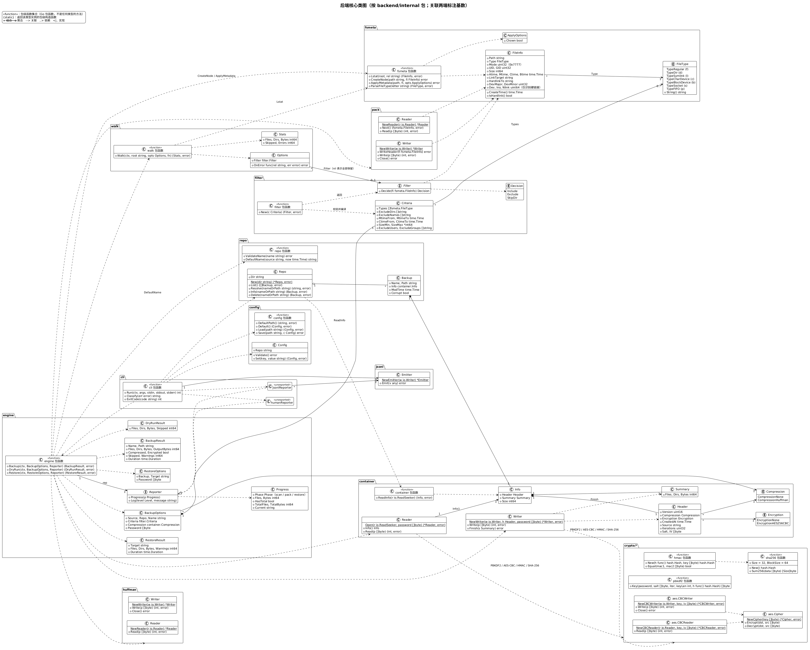
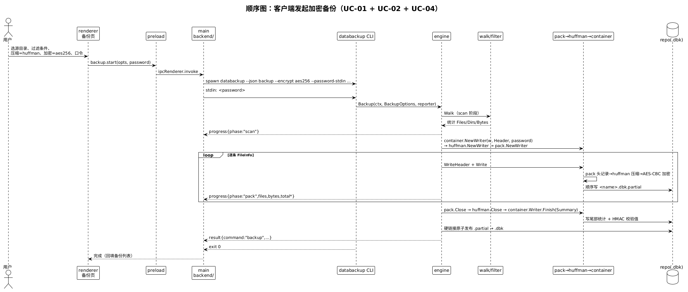
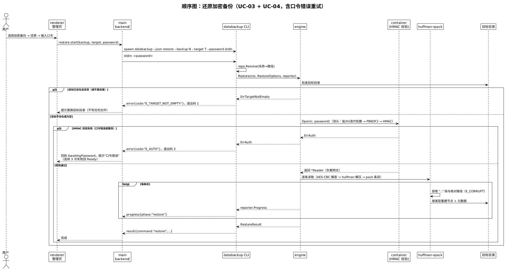
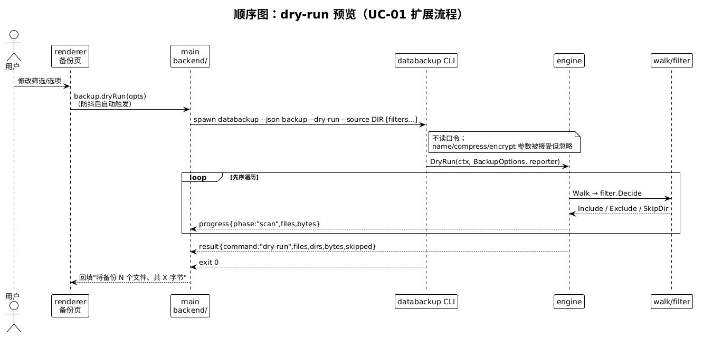
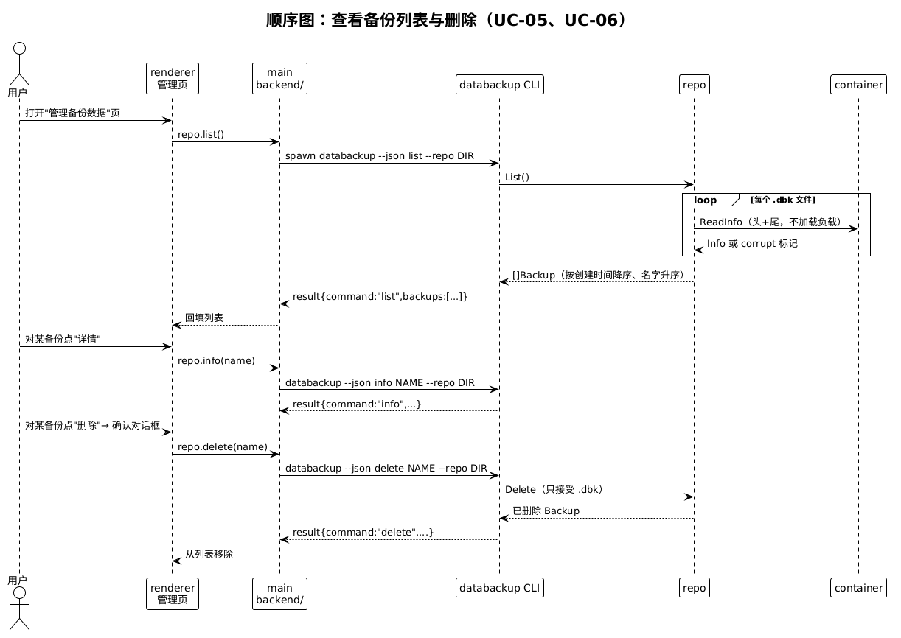
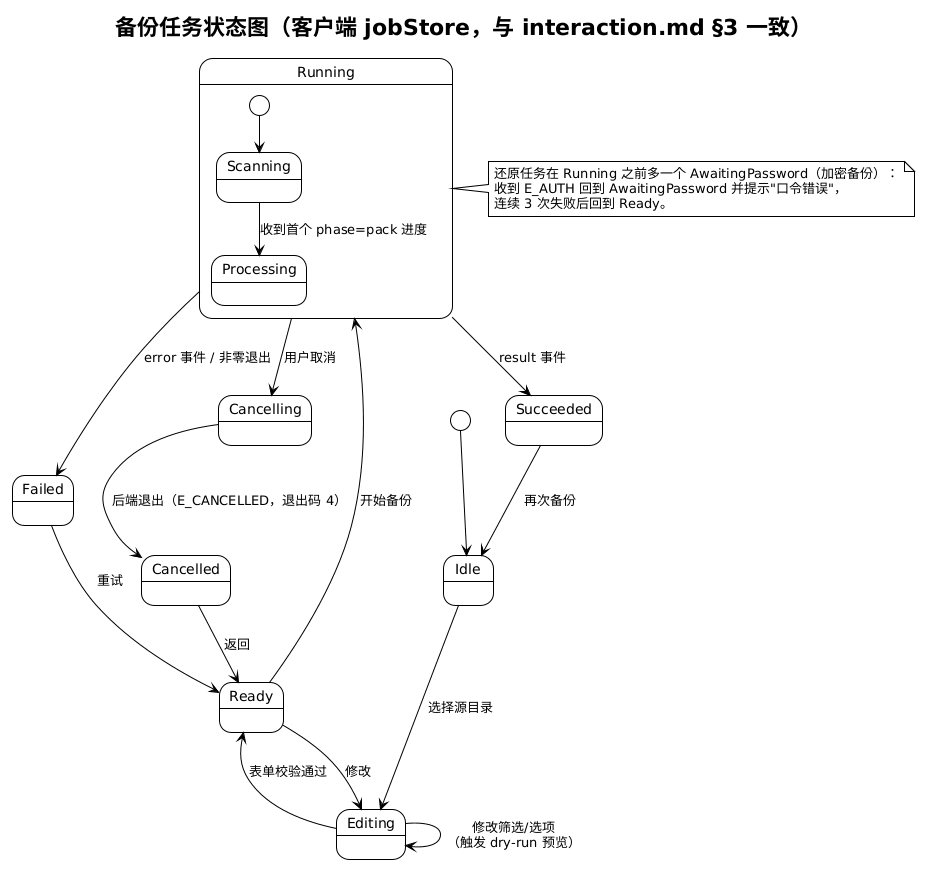

# 系统设计文档

<!-- 负责任务：M1-2。必须与 docs/architecture/overview.md 及代码保持一致。 -->

## 1. 开发环境和工具

### 1.1 开发环境

（1）硬件平台：x86-64 个人计算机。

（2）操作系统：开发主机 Windows + Docker Desktop；**构建/测试/演示均在容器或 WSL2 中的 Ubuntu 22.04/24.04**（目标平台 Linux，与课程要求一致）。

（3）编译环境：Go 1.27（`go build`/`go test`/`gofmt`/`staticcheck`）、Node.js + npm（electron-vite 构建）、GNU Make；统一封装在 `docker/dev.Dockerfile` 开发镜像内，`bash scripts/docker.sh check` 一键门禁，CI 使用同一镜像与依赖安装脚本。

（4）IDE：Windsurf（配合 AI 编码 agent）；本项目使用 AI 辅助开发。

### 1.2 依赖库

**后端：仅 Go 标准库，零第三方生产依赖。** 归档（MyPack）、压缩（Huffman）、密码学（SHA-256、HMAC、PBKDF2、AES-256-CBC）全部自研——课程规定第三方实现的扩展功能减半记分；`scripts/check-imports.sh` 在 lint 阶段强制拦截 `archive/*`、`compress/*`、`crypto/aes|cipher|sha*|hmac|pbkdf2`、`golang.org/x/*` 等导入。唯一允许的测试依赖是 `github.com/rogpeppe/go-internal/testscript`（CLI 黑盒测试）。

**客户端**：Electron 44、React 19、TypeScript 5.9、electron-vite 5、electron-builder 26（打包 AppImage/deb）；界面库 Tailwind v4 + shadcn/ui 及配套（zustand、zod、sonner 等，版本在 `client/package.json` 精确锁定）；测试 Vitest 5 + Playwright 1.64。界面库不参与备份逻辑——所有备份/还原/过滤/压缩/加密均由 Go 后端完成，客户端只做界面与进程调用。

## 2. 总体设计

### 2.1 系统结构设计

#### 2.1.1 顶层系统结构

##### 2.1.1.1 构件图

（源文件 `diagrams/component-top.puml`。）

##### 2.1.1.2 构件图描述

系统由两个可独立部署的构件组成：

- **客户端（Electron）**：renderer（React 界面）只经 `preload` 暴露的 `window.databackup` 白名单 API 与 `main` 进程通信；`main` 负责窗口管理与后端调用，以 `spawn`（无 shell）启动 `databackup` 子进程，stdout 按行解析 JSONL 事件，口令仅经 stdin 传递。安全三件套 `contextIsolation/sandbox/nodeIntegration=false` 不变。
- **后端（Go）**：`databackup` CLI 单二进制，读写备份仓库（`.dbk` 文件目录）、配置文件与用户文件系统。**系统不使用数据库**（ADR-005）：备份列表与详情由扫描 `.dbk` 文件头尾得出，仓库即文件系统目录。

两构件间的唯一接口是 `../architecture/cli-contract.md` 冻结的 CLI/JSONL 协议，两端各有契约测试比对协议样例。

#### 2.1.2 子系统一结构（后端核心）

##### 2.1.2.1 构件图

（源文件 `diagrams/component-backend.puml`。）

##### 2.1.2.2 构件图描述

后端按数据流水线分层，依赖方向自上而下（`docs/architecture/overview.md` §2）：

- **入口层**：`cli`（子命令/参数/输出/错误映射）→ `jsonl`（协议类型与 `Emitter`）、`version`。
- **编排层**：`engine` 编排 `walk → filter → pack → [huffman] → container(→[crypto])` 的备份流水线及其逆过程的还原流水线；进度节流在 engine 完成（每阶段 ≤10 次/秒，阶段结束必发一次）。
- **原语层**：`fsmeta`（文件信息模型与 Linux 元数据读写）、`walk`（先序遍历+硬链接识别）、`filter`（Include/Exclude/SkipDir 判定）、`pack`（MyPack 归档）、`huffman`（分块规范 Huffman）、`crypto/sha256|hmac|pbkdf2|aes`（手写密码学原语）、`container`（`.dbk` 容器：明文头+负载+尾部统计+校验值）。
- **支撑层**：`repo`（仓库扫描/查看/删除/名称规则）、`config`（`config.json` 读写）、`testutil`（测试夹具）。

原语包不得依赖 `engine`/`cli`，可独立测试与并行开发；面向用户的错误一律为包级哨兵错误，经 `cli.Classify` 映射为契约 §4 的错误码与退出码。

#### 2.1.3 子系统二结构（客户端）

##### 2.1.3.1 构件图

（源文件 `diagrams/component-client.puml`。）

##### 2.1.3.2 构件图描述

客户端三进程结构（`docs/client/interaction.md` §2）：

- **main**：`index.ts` 创建无边框窗口；`window.ts` 提供最小化/最大化/关闭 IPC 与最大化状态推送；`backend.ts` 维护 jobs 注册表，把 `spawn` 子进程的 JSONL 流转为 IPC 事件推给 renderer，并支持取消与口令 stdin 注入。
- **preload**：`contextBridge` 暴露 `window.databackup`（备份/还原/仓库/配置/窗口命名空间），方法签名与 `src/shared/api.ts` 冻结类型一致。
- **renderer**：zustand 三个 store——`jobStore`（备份/还原任务状态机，见 §4.2）、`backupsStore`（列表缓存）、`settingsStore`；三个页面——备份、管理备份数据、备份设置；`src/shared/` 协议与 API 类型为冻结件，与后端 `jsonl` 类型经契约测试保持一致。

## 3. 静态建模

### 3.1 系统对象模型

（源文件 `diagrams/class-backend.puml`。按包组织，关联标注了主要依赖方向；`*--` 为组合、`o--` 为聚合、`..>` 为依赖。）

### 3.2 类（对象）描述

以下类描述与 `backend/internal/*` 各包已冻结的公开 API（`go doc`）一一对应；接口 `engine.Reporter` 由 `cli` 实现适配到 JSONL 事件。

#### 3.2.1 fsmeta.FileInfo 类（对象）

##### 3.2.1.1 类描述

文件信息模型：流水线各阶段传递的统一"文件"视图，覆盖 Linux 全部文件类型与需要恢复的元数据。字段已冻结（只允许新增）。

##### 3.2.1.2 属性描述

| 属性 | 类型 | 说明 |
|---|---|---|
| Path | string | 相对源目录的路径（`/` 分隔） |
| Type | FileType | `f`普通 `d`目录 `l`软链接 `c`字符设备 `b`块设备 `s`套接字 `p`FIFO |
| Mode | os.FileMode | 权限位 |
| UID, GID | uint32 | 属主/属组 |
| Size | int64 | 字节数（普通文件） |
| ATime, MTime, CTime, BTime | time.Time | 访问/修改/状态变更/创建时间 |
| LinkTarget | string | 软链接目标 |
| Dev, Rdev | uint64 | 所在设备号 / 设备文件的设备号 |
| Ino, Nlink | uint64 | inode 号（硬链接识别）、链接数 |

##### 3.2.1.3 方法描述

| 方法 | 说明 |
|---|---|
| `CreateTime() time.Time` | 返回创建时间（btime 不可用时回退 ctime） |
| `Lstat(path) (FileInfo, error)` | 读取路径元数据（不跟随软链接） |
| `CreateNode(fi, dir)` | 按类型创建节点（文件/目录/链接/FIFO/设备） |
| `ApplyMetadata(fi, path)` | 恢复权限、属主、时间戳 |

#### 3.2.2 filter.Criteria / filter.Filter 类

##### 3.2.2.1 类描述

`Criteria` 是过滤条件集合；`Filter` 由 `New(Criteria)` 构造（校验非法条件返回 `ErrInvalidCriteria`），对 `FileInfo` 逐条给出 `Include / Exclude / SkipDir` 判定。语义以 `cli-contract.md` §2.1 为准。

##### 3.2.2.2 属性描述

| 属性 | 类型 | 说明 |
|---|---|---|
| Types | []FileType | 类型集合（空=全部类型） |
| ExcludeDirs | []string | 排除子目录（相对源目录） |
| ExcludeNames | []string | 文件名排除正则（RE2，匹配 `path.Base`） |
| MtimeFrom/To、CtimeFrom/To | time.Time | 修改/创建时间闭区间，零值不限 |
| SizeMin/Max | \*int64 | 尺寸闭区间（仅普通文件），nil 不限 |
| ExcludeUsers、ExcludeGroups | []string | 排除的属主/属组（名称或数字 ID） |

##### 3.2.2.3 方法描述

| 方法 | 说明 |
|---|---|
| `New(c Criteria) (*Filter, error)` | 构造并校验：正则非法、区间反向、用户/组名不存在 → `ErrInvalidCriteria` |
| `(f *Filter) Decide(fi FileInfo) Decision` | 排除目录→SkipDir；目录只看 Types；非目录须过全部条件 |

#### 3.2.3 pack.Writer / pack.Reader 类

##### 3.2.3.1 类描述

MyPack 归档的写/读器，用法仿 `archive/tar`：每条目 = 512 字节头记录 + 数据块（512 对齐）；长文件名多头块；头含校验和；归档以零块结尾。`Reader` 拒绝 `..` 与绝对路径（`ErrUnsafePath`），格式损坏返回 `ErrCorrupt`。

##### 3.2.3.2 属性描述

无公开字段；写/读状态内部维护（当前条目、剩余字节）。

##### 3.2.3.3 方法描述

| 方法 | 说明 |
|---|---|
| `NewWriter(w io.Writer) *Writer` | 创建归档写器 |
| `(w) WriteHeader(fi FileInfo) error` | 写入一条目元数据头 |
| `(w) Write(b []byte) (int, error)` | 写当前条目数据（普通文件） |
| `(w) Close() error` | 写结尾零块 |
| `NewReader(r io.Reader) *Reader` | 创建归档读器 |
| `(r) Next() (FileInfo, error)` | 读下一条目元数据；校验头与路径安全性 |
| `(r) Read(b []byte) (int, error)` | 读当前条目数据 |

#### 3.2.4 huffman.Writer / huffman.Reader 类

##### 3.2.4.1 类描述

分块流式 Huffman 编解码：输入按 `BlockSize`（1 MiB）分块，每块使用规范 Huffman 码并把码长表写入块头；`Close` 写流结束标记。`Reader` 对一切非法输入返回包装 `ErrCorrupt` 的错误，不 panic、不死循环。

##### 3.2.4.2 属性描述

`BlockSize` 常量（1 MiB）；写/读器无公开字段。

##### 3.2.4.3 方法描述

| 方法 | 说明 |
|---|---|
| `NewWriter(w io.Writer) *Writer` | 创建压缩写器 |
| `(w) Write(b []byte) (int, error)` | 缓冲并逐块压缩写出 |
| `(w) Close() error` | 冲刷最后一块并写结束标记 |
| `NewReader(r io.Reader) *Reader` | 创建解压读器（可延迟到首次 Read 校验） |
| `(r) Read(b []byte) (int, error)` | 逐块解压；EOF 于结束标记 |

#### 3.2.5 container 相关类（Header / Summary / Info / Writer / Reader）

##### 3.2.5.1 类描述

`.dbk` 容器格式：明文 `Header`（魔数、版本、算法、创建时间、源目录、KDF 参数、盐、IV）+ 负载（MyPack 流，可选 Huffman、可选 AES-256-CBC）+ 明文 `Summary`（统计）+ 校验值（加密：HMAC-SHA256；不加密：SHA-256）。`Open` 先完整校验再允许读取；`ReadInfo` 只读头尾用于 list/info。

##### 3.2.5.2 属性描述

| 类 | 关键属性 | 说明 |
|---|---|---|
| Header | Version、Compression、Encryption、CreatedAt、Source、Iterations、Salt、IV | 加密字段仅加密时有意义 |
| Summary | Files、Dirs、Bytes | 写在尾部的统计，口径同 backup 结果 |
| Info | Header、Summary、Size | list/info 使用的元信息 |

##### 3.2.5.3 方法描述

| 方法 | 说明 |
|---|---|
| `NewWriter(w, opts)` / `(w) Write` / `(w) Finish` | 流式写容器；`Finish` 写尾部与校验值 |
| `Open(r, password)` | 读头→（加密时）派生密钥、校验 HMAC→返回负载 Reader；失败给 `ErrAuth`/`ErrPasswordRequired`/`ErrCorrupt` |
| `ReadInfo(path 或 r)` | 只读头尾得 `Info`（不校验完整负载、不解密） |

#### 3.2.6 engine 相关类（BackupOptions / RestoreOptions / Reporter）

##### 3.2.6.1 类描述

编排层：`Backup`/`DryRun`/`Restore` 三个入口把选项对象与 `Reporter` 串联到流水线。`Reporter` 是接口（进度+日志），由 `cli` 实现为 JSONL 事件或人类可读输出。

##### 3.2.6.2 属性描述

| 类 | 属性 | 说明 |
|---|---|---|
| BackupOptions | Source、Repo、Name、Criteria、Compression、Password | Name 空时用默认名；Password 非 nil 表示 AES-256 |
| RestoreOptions | Backup、Target、Password | Backup 为已解析的 `.dbk` 路径；Target 必须不存在或为空 |
| Progress | Phase、Files、Bytes、HasTotal、TotalFiles、TotalBytes、Current | Phase ∈ scan/pack/restore |

##### 3.2.6.3 方法描述

| 方法 | 说明 |
|---|---|
| `Backup(ctx, opts, rep) (BackupResult, error)` | scan→pack→.partial→原子改名；失败/取消删 .partial |
| `DryRun(ctx, opts, rep) (DryRunResult, error)` | 只遍历统计，不写文件 |
| `Restore(ctx, opts, rep) (RestoreResult, error)` | 先完整校验再写文件；取消不回滚 |
| `Reporter.Progress(p)` / `Reporter.Log(level, msg)` | 进度与日志回调（同 goroutine 调用，已节流） |

#### 3.2.7 repo.Repo / repo.Backup 类

##### 3.2.7.1 类描述

仓库目录对象：扫描 `.dbk` 文件、读容器头尾得列表；名称↔路径解析；删除只允许 `.dbk`。

##### 3.2.7.2 属性描述

| 属性 | 说明 |
|---|---|
| `Repo.Dir` | 仓库目录绝对路径 |
| `Backup.Name/Path` | 去 `.dbk` 的名字 / 绝对路径 |
| `Backup.Info` | 容器头尾信息（Corrupt 时为零值） |
| `Backup.ModTime` | 文件修改时间（损坏备份代替创建时间展示） |
| `Backup.Corrupt` | 头尾无法解析标记 |

##### 3.2.7.3 方法描述

| 方法 | 说明 |
|---|---|
| `New(dir)` | 返回仓库对象（不要求已存在） |
| `List()` | 全部 `.dbk`，按创建时间降序、名字升序 |
| `Resolve(nameOrPath)` | 含 `/` 视为路径，否则仓库内名称（可省 `.dbk`） |
| `Info(nameOrPath)` / `Delete(nameOrPath)` | 读详情 / 删除并返回信息 |
| `ValidateName(name)` / `DefaultName(source, now)` | 名称规则校验 / `<源目录名>-<YYYYMMDD-HHMMSS>` |

#### 3.2.8 config.Config 类

##### 3.2.8.1 类描述

用户配置（当前仅 `repo`），JSON 存于 `$XDG_CONFIG_HOME/databackup/config.json`；`Save` 经同目录临时文件原子改名，并发写不损坏文件。

##### 3.2.8.2 属性描述

| 属性 | 类型 | 说明 |
|---|---|---|
| Repo | string | 备份仓库目录绝对路径（JSON key `repo`） |

##### 3.2.8.3 方法描述

| 方法 | 说明 |
|---|---|
| `DefaultPath()` / `Default()` | 配置路径（XDG→HOME/.config）/ 默认配置（`~/DataBackup`） |
| `Load(path)` / `Save(path, c)` | 读取（不存在→默认、缺字段补默认）/ 校验后原子写入 |
| `(c) Validate()` / `(c) Set(key, value)` | 校验（绝对路径；存在须为目录）/ 写入单键（未知→`ErrInvalid`） |

### 3.3 其它静态建模方式（可选）

对象关系补充见 §2.1 构件图与 §5 的 `.dbk` 容器格式字段表；客户端类型关系由冻结的 `client/src/shared/protocol.ts`、`api.ts` 定义并经契约测试约束，不再另绘。

## 4. 动态建模

### 4.1 系统场景

#### 4.1.1 场景：客户端发起加密备份（含过滤/压缩/加密）

##### 4.1.1.1 场景描述

用户在"备份"页选择源目录、过滤条件、Huffman 压缩与 AES-256 加密并输入口令；客户端 spawn `databackup backup`，进度经 JSONL 实时回显，成功后仓库新增 `.dbk`（UC-01/02/04）。

##### 4.1.1.2 顺序图

（源文件 `diagrams/seq-backup.puml`。）

##### 4.1.1.3 流程说明

1. renderer 收集参数与口令，经 preload 调 `backup.start`；main 以 `spawn`（无 shell）启动 `databackup --json backup --encrypt aes256 --password-stdin …`，口令写入 stdin。
2. cli 解析校验参数后调 `engine.Backup`：先 scan（walk+filter 统计总量），再逐条 `pack.WriteHeader/Write` → huffman 压缩 → AES-CBC 加密，顺序写 `<name>.dbk.partial`；progress 事件节流回传。
3. 全部写完后 `container.Finish` 写尾部与 HMAC 校验值，`.partial` 原子改名为 `.dbk`；`result` 事件输出统计；进程 exit 0，客户端回填备份列表。
4. 失败/取消：删除 `.partial`，输出对应 `error.code` 与非零退出码。

#### 4.1.2 场景：还原加密备份（含口令校验）

##### 4.1.2.1 场景描述

用户对加密备份发起还原；后端先校验 HMAC（口令错误 → `E_AUTH`，客户端回到口令输入态，连续 3 次失败回到就绪态），校验通过后解密解压逐条重建（UC-03/04，FR-17）。

##### 4.1.2.2 顺序图

（源文件 `diagrams/seq-restore-encrypted.puml`。）

##### 4.1.2.3 流程说明

1. `cli` 先经 `repo.Resolve` 把名称解析为 `.dbk` 路径，再调 `engine.Restore`。
2. `container.Open` 读头部（盐/IV/迭代轮数）→ PBKDF2 派生密钥 → HMAC 校验；失败返回 `ErrAuth`（E_AUTH、退出码 3）且不写任何文件。
3. 校验通过后逐条读取：AES-CBC 解密 → huffman 解压 → pack 条目；拒绝 `..`/绝对路径条目（E_CORRUPT，路径穿越防护）；按类型创建节点并恢复元数据（目录最后设置）。
4. 目标目录在开始前检查：已存在且非空 → `E_TARGET_NOT_EMPTY`。

#### 4.1.3 场景：dry-run 预览

##### 4.1.3.1 场景描述

用户修改筛选条件时，客户端防抖触发 `backup --dry-run`，只扫描统计不写文件、不读口令，用于表单下方的预览（UC-01 扩展流程）。

##### 4.1.3.2 顺序图

（源文件 `diagrams/seq-dry-run.puml`。）

##### 4.1.3.3 流程说明

1. `cli` 接受 name/compress/encrypt 参数但忽略（契约 §2.1），不读口令。
2. `engine.DryRun` 仅执行 walk+filter：排除目录→SkipDir，目录只看 types，非目录过全部条件；progress{phase:"scan"} 回传。
3. 返回 `result{command:"dry-run",files,dirs,bytes,skipped}`，客户端展示预计规模。

#### 4.1.4 场景：查看备份列表与删除

##### 4.1.4.1 场景描述

"管理备份数据"页加载时调用 `list` 扫描仓库（无数据库，读容器头尾），用户可查看 `info` 详情或经确认对话框 `delete`（UC-05/06，FR-14）。

##### 4.1.4.2 顺序图

（源文件 `diagrams/seq-list-delete.puml`。）

##### 4.1.4.3 流程说明

1. `repo.List` 扫描 `.dbk`（忽略 `.partial` 与其他文件），逐文件 `container.ReadInfo` 读头尾；无法解析的文件以 `corrupt=true` 列出；按创建时间降序、名字升序。
2. `info` 读取单个备份的头尾元数据（不校验完整负载）。
3. `delete` 只接受 `.dbk`（显式路径必须 `.dbk` 结尾，否则 E_USAGE），客户端先二次确认。

### 4.2 系统状态

#### 4.2.1 备份任务状态切换

##### 4.2.1.1 状态描述

| 状态 | 含义 |
|---|---|
| Idle | 初始：未选源目录 |
| Editing | 编辑参数中；每次修改触发 dry-run 预览 |
| Ready | 表单校验通过，可开始 |
| Running（Scanning/Processing） | 后端执行中；scan 进度→Scanning，首个 pack 进度→Processing |
| Cancelling | 用户已请求取消，等待后端退出 |
| Succeeded / Failed / Cancelled | 结果态：result 事件 / error 或非零退出 / E_CANCELLED |

##### 4.2.1.2 状态转换图

（源文件 `diagrams/state-backup-job.puml`，与 `../client/interaction.md` §3 一致。）

##### 4.2.1.3 状态图说明

- 取消发 SIGINT→ctx 取消→后端删 `.partial`、以退出码 4 结束，状态机进 Cancelled；Failed/Cancelled 均可回到 Ready 重试。
- 还原任务在 Running 之前多一个 `AwaitingPassword`（加密备份）：`E_AUTH` 回到该态并提示"口令错误"，连续 3 次失败回到 Ready。

## 5. 数据库设计（如有）

**本系统不使用数据库**（ADR-005）。持久化只有三类文件：`.dbk` 备份文件、`config.json` 配置文件、源/还原目录本身。备份仓库的"列表查询"由扫描目录下 `.dbk` 文件并读取容器头尾完成——元数据冗余在容器内，无需索引。

`.dbk` 容器格式（`container` 包，字段见 `docs/architecture/overview.md` §4 与包注释）：

| 区段 | 字段 | 说明 |
|---|---|---|
| 头部（明文） | magic | 格式魔数 |
| | version | 格式版本（当前 `FormatVersion=1`） |
| | compression | 负载压缩算法（none/huffman） |
| | encryption | 负载加密算法（none/aes256-cbc） |
| | createdAt | 备份创建时间（秒精度） |
| | source | 备份时源目录绝对路径 |
| | iterations, salt, IV | PBKDF2 迭代轮数（默认 100000）、盐、CBC 初始向量（仅加密） |
| 负载 | MyPack 流 | `pack.Writer` 产出的归档字节流，可选 Huffman 压缩、可选 AES-256-CBC 加密 |
| 尾部（明文） | files, dirs, bytes | 备份统计（同 backup 结果口径） |
| 校验值 | HMAC-SHA256 或 SHA-256 | 加密：HMAC(头部‖密文‖尾部)，encrypt-then-MAC；未加密：SHA-256(头部‖负载‖尾部) |

MyPack 负载内部：每条目为 512 字节头记录（路径、类型、权限、属主、时间戳、尺寸、链接目标、设备号、校验和等）+ 数据块（512 对齐），长文件名使用多头块，归档以零块结束。头块为定长小端二进制字段：魔数 `MYPK`、版本、类型码（沿用 tar 的 `0`~`6`，套接字扩展为 `7`）、CRC-32 校验和、权限/属主/设备号、长度、纳秒级 mtime/atime/ctime/btime，以及 408 字节内联名字区（放不下时溢出到扩展块）。读取时拒绝绝对路径、`..` 段和位于已出现软链接之下的路径。完整字段表见 `../architecture/mypack-format.md`。

配置存储：`$XDG_CONFIG_HOME/databackup/config.json`（未设置 XDG 时 `~/.config/...`），JSON 对象，当前仅 `repo`（绝对路径）一键；`Save` 走同目录临时文件原子改名。
