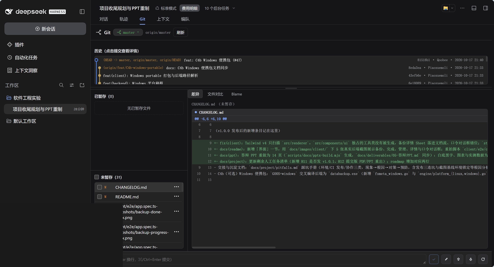
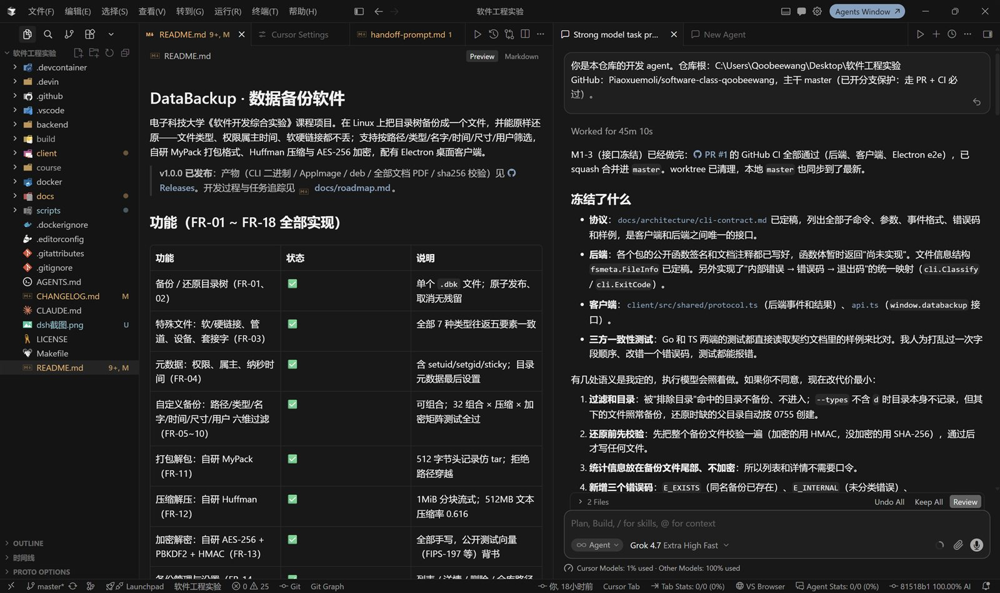
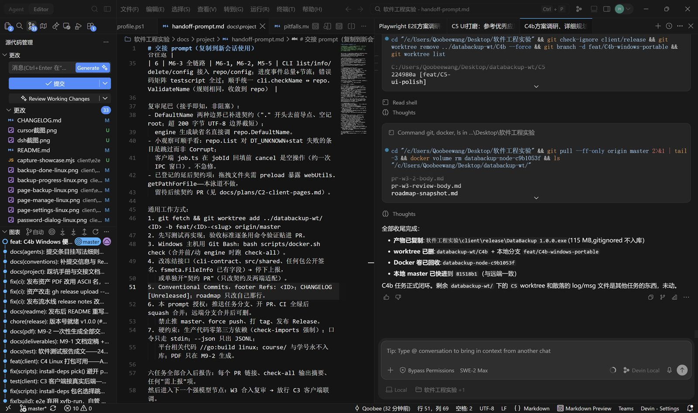
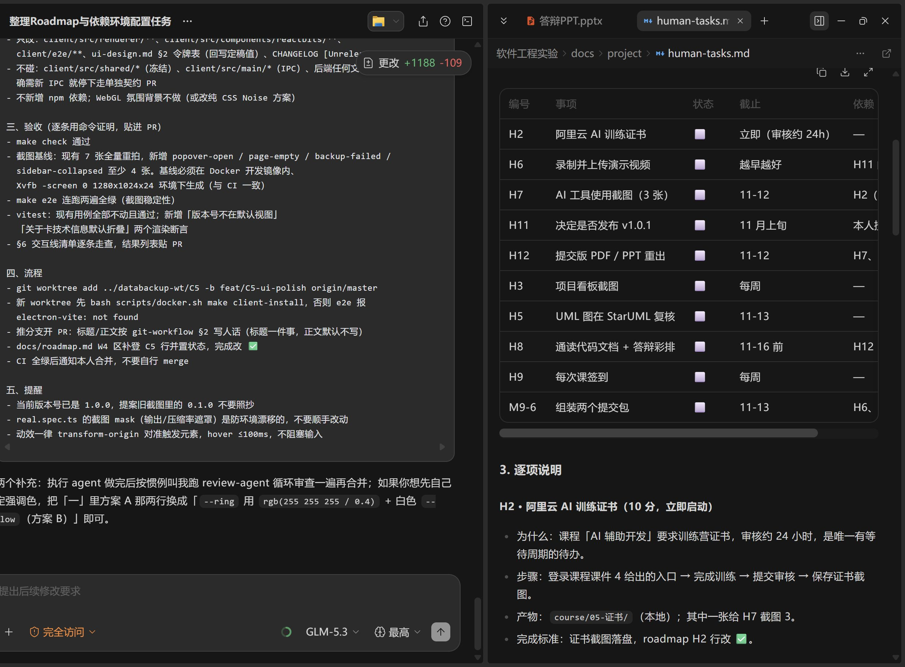

# 七、AI 开发工具使用总结

本项目全程采用 AI 辅助开发：需求文档、架构设计、全部功能代码、测试用例与打包发布均由编码 agent 完成，本人承担任务拆分、审查决策与验收。

## 7.1 使用的 AI 工具

| 工具 | 用途 | 使用方式 |
|---|---|---|
| DeepSeek Harness（DSH） | 收尾阶段的任务规划、截图与 PPT 重制、文档与发布流水线；Git 面板与后台任务管理 | 仓库根 `AGENTS.md` 作为规则入口；会话内按 roadmap 拆分任务，改动经 Git 面板逐项复核后提交 |
| Cursor（Agent 模式） | 接口冻结、客户端与后端模块实现、代码复审 | 每个任务一个 worktree + 分支；对话里给出约束与验收标准，改动在编辑器中逐文件审阅 |
| Devin | 并行 worktree 任务：Windows 平台适配、文档同步、批量重构 | 任务提示词来自 `docs/project/handoff-prompt.md`；完成后按 PR 模板提交，CI 门禁通过再合并 |
| ZCode | 强节点任务与 review-agent 循环：集成泳道、联调、打包、测试证据 | 按 `docs/roadmap.md` 的依赖顺序执行；复杂问题拆成并行 subagent，审查报告落在 `docs/plans/*-review.md` |
| 阿里云百炼 | 课程要求的 AI 训练证书与 API 体验 | 本人自行完成（H2）；证书单独提交，不占用本报告版面 |

四类编码工具的会话截图如下（已隐去账户金额与无关项目名）：

*图 7-1 DSH：按 roadmap 拆分任务，在 Git 面板逐项复核待提交内容。*

*图 7-2 Cursor：接口冻结阶段，agent 给出契约要点，改动在编辑器中逐文件审阅。*

*图 7-3 Devin：并行 worktree 中的任务执行与提交记录。*

*图 7-4 ZCode：按 roadmap/规范执行任务，并在人工确认点停下等待确认。*

## 7.2 使用方法与效果评价

- **方法**：仓库以 `AGENTS.md` 为全局规则入口（硬性约束：扩展功能必须自研、生产代码零第三方依赖、不提交学号凭据等），任何 agent 进入仓库即受约束；`docs/roadmap.md` 将 40 余个任务按依赖分波次、按模型强度分级调度；每个任务"先写测试再写实现"，`make check` / `check-all` 与 CI 全绿才可合并。
- **效果**：2026-10-16 至 10-17 完成 W3 集成 → C3 联调 → C4 打包 → 测试证据全部工作，功能较计划提前冻结；全仓内嵌 400+ 个测试用例编号，核心包覆盖率 87%~100%，静态检查零告警；AI 产出经 review-agent 循环审查，发现并修复了多处深层问题（如 e2e 截图基线随环境元数据漂移的根因）。AI 辅助压缩了工期，但质量依赖"规则约束 + 任务分级 + 独立审查 + 自动化门禁"四个环节，缺一不可。

# 八、实验结论

**功能选择**：基础要求（数据备份/还原）+ 全部扩展项——文件类型（FR-03）、元数据（FR-04）、六维过滤（FR-05~10）、打包（FR-11）、压缩（FR-12）、加密（FR-13）、图形界面（FR-16），另加仓库管理、配置、安全健壮性、进度日志四项支撑功能（FR-14/15/17/18）。

**技术实现**：

| 功能 | 技术 |
|---|---|
| 后端 | Go 1.27（编译型，生产代码零第三方依赖；扩展功能全部自研） |
| 归档 | 自研 MyPack 格式：512 字节小端头记录、CRC-32、长路径扩展块、双零块结尾，Reader 拒绝绝对路径/`..`/链接下路径 |
| 压缩 | 自研 Huffman：1MiB 分块流式规范编码，块头含码长表 |
| 加密 | 手写 SHA-256 / HMAC / PBKDF2 / AES-256-CBC + PKCS#7；容器 encrypt-then-MAC，错误口令退出码 3 |
| 客户端 | Electron + React + TypeScript：三页面、口令经 stdin 传递、JSON Lines 实时进度 |
| 打包 | electron-builder 产出 AppImage/deb，内置后端二进制；WSL2+WSLg 运行说明 |

**最终效果**：FR-01~18 全部实现并通过自动化测试（400+ 用例，32 组合过滤×压缩×加密矩阵全过，端到端界面真实链路验证）；512MB 文本备份压缩率 0.616、吞吐 ≈97MB/s，10,000 个小文件备份 0.16s；race 检测与 fuzz（488 万次执行）干净，静态检查零告警。产物：`DataBackup-1.0.1.AppImage`、`databackup-client_1.0.1_amd64.deb`、独立 CLI 二进制与可选的 Windows 便携包。

# 九、总结及心得体会

【草稿，请本人润色后定稿】

1. 软件工程的"过程纪律"比单点技术更决定交付质量：本项目把需求（FR 编号）、任务（roadmap 泳道）、验证（用例编号内嵌代码）三者全程可追踪，任何一处行为变更都能回溯到需求与测试，这是两日冲刺能够不失控的根本原因。
2. 自研底层（格式/压缩/加密）的价值在于"逼真"地经历了完整设计：公开测试向量（FIPS-197、RFC 等）作为外部锚点，使手写实现可信，这一方法论可迁移到任何需要可信组件的场景。
3. AI 辅助开发的正确定位是"高强度执行者 + 纪律接受者"：规则（AGENTS.md）、分级调度与独立审查构成闸门，AI 的产能才能转化为质量而不是返工。
4. 跨端工程（Go 后端 + Electron 客户端）中，冻结接口契约（CLI/JSONL 协议文档 + 双端类型一致性测试）使两线并行开发几乎零集成冲突。

# 十、对本实验过程及方法、手段的改进建议

【草稿，请本人润色后定稿】

1. 契约先行可以更早落自动化：若 W0 就建立"文档 ↔ Go 类型 ↔ TS 类型"三方一致性测试，可省去中期的契约补遗 PR。
2. 性能剖析宜随开发持续进行而非收尾补做：pprof 火焰图若在 Huffman/AES 实现当周采集，可更早发现单线程瓶颈并评估并行化。
3. 演示环境的图形栈（WSLg/字体/截图基线）跨机器差异大，建议项目初期就固定"基线生成环境 = CI 环境"，避免基线漂移排查成本。
4. 对单人 + AI 组队而言，人工任务（视频录制、平台证书等）是不可并行化的瓶颈，应与代码冲刺同周启动。
