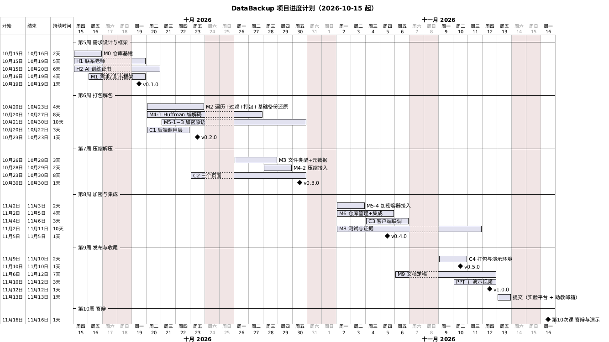

# 项目进度计划

> 基准日：2026-10-16（第 5 周周五）。课次日期按"每周一上课"推算 ⚠️，以实际课表为准；课表确认后更新本表与甘特图。
> 维护规则：任务状态以 `../roadmap.md` 为准；每完成一个里程碑或计划变动时更新本文 §4 状态表与 §6 变更记录。PDF 只在项目最后（M9-2）生成。
> **开发节奏（2026-10-16 调整）**：开发全部由 agent 执行，W3→W4→W5 压缩为 10-16 晚 ~ 10-18 的两日冲刺；之后代码冻结，第 6~9 周只剩人工任务与提交窗口。课程节点与提交截止不变。

## 1. 关键日期

| 日期 | 事件 |
|---|---|
| 2026-10-16 晚 ~ 10-17 | **agent 冲刺上半段**：W3 集成泳道六任务串行（M2-5→M3-1→M3-2→M4-2→M5-5→M6-3） |
| 2026-10-18 | **agent 冲刺下半段**：C3 联调 → C4 打包 + M8 测试证据 + M9-1 文档定稿并行 → M9-2 一次性 PDF → M9-3 PPT / M9-4 视频脚本；**功能冻结** |
| 2026-10-19（周一） | 第 6 次课；代码已冻结，课上可演示真实备份/还原 |
| 2026-10-26（周一） | 第 7 次课 |
| 2026-11-02（周一） | 第 8 次课 |
| 2026-11-09（周一） | 第 9 次课 |
| 2026-11-12（周四） | 提交物最终核对（PDF、视频链接、提交包） |
| 2026-11-13（周五） | 提交（预留 2 个工作日缓冲） |
| **2026-11-16（周一）** | **第 10 次课：提交截止 + 答辩 + 演示** |

## 2. 甘特图

（源文件 `diagrams/schedule-gantt.puml`，由 `bash scripts/docker.sh docs` 渲染。）

## 3. 周计划

任务波次与并行泳道的定义见 `../roadmap.md` §1。

| 周 | 日期 | 课程主题 | 波次 | 目标产出 | 版本 |
|---|---|---|---|---|---|
| 第 5 周 | 10-12 ~ 10-18 | 需求设计与程序框架 | M0 + W0 + W1 + W2 ✅；**W3 → W4 → W5 两日冲刺（10-16 晚 ~ 10-18）** | 全部功能代码、WSL 打包验证、测试证据、四份交付文档与全部 PDF、PPT、视频脚本 | v0.1.0（需求+设计+框架已齐，可随时打）→ v1.0.0 功能冻结 10-18 |
| 第 6~9 周 | 10-19 ~ 11-15 | 打包解包 / 压缩解压 / 加密解密与系统集成 / 软件发布与项目收尾 | 缓冲期（代码已冻结） | 只做人工任务：H2 证书、H3 看板截图、H9 签到、H5 StarUML 复核、H6 视频录制、H7 AI 截图、H8 通读彩排；需要时打 v1.0.0 | — |
| 第 10 周 | 11-16 | 项目答辩与成果展示 | — | 11-13 前组装提交包（源码 + 可执行程序 + 构建脚本 + 视频链接）；现场答辩 + 演示 | v1.0.0 |

## 4. 当前状态

| 里程碑 | 计划完成 | 状态 | 备注 |
|---|---|---|---|
| M0 仓库基建与调研 | 10-15 | ✅ | 开工前本人待办见 `kickoff-checklist.md` |
| W0：M1-3 接口冻结 / M1-1 需求 / C0 客户端底座 | 10-17 / 10-19 / 10-21 | ✅ | 10-16 全部合入 |
| W1：原语与框架八条泳道 | 10-24 | ✅ | 10-16 全部合入，含复审修复 |
| W2：遍历、过滤、容器、仓库、页面 | 10-28 | ✅ | 全部于 10-16 合入（M2-1、M2-2、M5-4、M6-2、C2），较计划提前约两周 |
| W3：集成泳道（串行） | 10-17 | ✅ | 10-16 全部合入：M2-5~M5-5 一个 PR（engine 全流水线），M6-3 全链路一个 PR，另有契约补遗 PR |
| W4：联调、打包、测试证据 | 10-18 | ✅ | C3（#31）、C4（#35）已合入；M8-1~4 测试报告与全部证据成文（2026-10-17）；WSL 演示环境就绪（H10 ✅） |
| W5：文档定稿、PDF、视频脚本 | 10-18（agent 侧） | 🟨 | M9-1/9-3/9-4 完成待合并；M9-2 仓库版 PDF 就绪后生成；提交版需本人学号与 H6/H7 |
| M9-5/M9-6 发布与提交包 | 11-13 前 | ⬜ | 依赖人工输入：H6 视频链接、平台地址/助教邮箱（本人另行取得）、真实学号 |
| 人工任务包（H5/H6/H7/H8/H10） | 10-18 后 ~ 11-13 | 🟨 | H10 已由 agent 代办完成（2026-10-17，WSL 24.04 工具链装齐）；其余代码冻结后即可开始，越早越好 |
| H2 AI 训练证书（本人） | 10-20 | ⬜ | 审核需约 24h |

## 5. 风险与缓冲

| 风险 | 影响 | 预案 |
|---|---|---|
| 考勤不满足 8/10 | 评分公式可能不生效 | 本人自行处理（10-16 起不再列入任务表）；剩余课次全勤（H9） |
| W3 六任务串行卡壳 | 冲刺顺延（最长链） | M2-5 最先开工；单点阻塞超半天就上报，必要时先交付无加密版、M5-5 最后接入 |
| 客户端联调问题 | GUI 分与演示效果 | 客户端先用 mock 后端开发；CLI 本身可独立演示兜底 |
| WSLg/Electron 显示问题 | 演示环境 | 备选：Ubuntu 22.04 虚拟机桌面；C4b 便携包也可兜底课堂演示 |
| 人工任务集中到期（H1/H2/H6/H10） | 提交物缺件 | 代码 10-18 冻结后立即启动；H6 视频链接阻塞 M9-6 |
| 文档与代码不一致 | 文档"一致性"失分 | 规范要求行为变更同 PR 改文档；M9-1 统一核对 |

## 6. 变更记录

| 日期 | 变更 |
|---|---|
| 2026-10-15 | 初版：后端选 Go、客户端选 Electron，按 10 次课倒排 |
| 2026-10-15 | 调研后改为波次 + 泳道并行；新增 C0 客户端底座；PDF 改为 11-12 一次性生成 |
| 2026-10-16 | W0/W1/W2 全部合入，W2 较计划提前约两周；进入 W3 集成泳道节点 |
| 2026-10-16 | 开发改为 agent 两日冲刺：W3→W4→W5 于 10-16 晚 ~ 10-18 完成并功能冻结；课程节点、PDF 一次生成与提交截止不变 |
| 2026-10-17 | H10 由 agent 代办完成：修复 install-deps.sh 在 Ubuntu 24.04 的虚拟包 bug 后，WSL 内装齐锁定版工具链；环境类问题此后一律 agent 处理（本人指示） |
| 2026-10-17 | W4 全部完成：C3/C4 合入，M8-1~4 测试报告成文（覆盖率/race/fuzz/静态检查/性能全绿）；进入 W5 收尾 |
