# 路线图与任务拆分

> 任务 ID 全仓库通用：分支名、提交 footer（`Refs: M2-3`）、PR、计划文档都用它。
> 状态：⬜ 未开始 / 🟨 进行中 / ✅ 完成 / ⏸ 搁置。负责：🤖 agent 独立完成；👤 必须本人完成；🤝 agent 产出 + 本人验收。
> 日期见 `project/schedule.md`；开工前检查清单见 `project/kickoff-checklist.md`。完成任务后只修改**自己那一行**的状态。

## 1. 并行开发总设计

### 1.1 关键路径（必须串行）

```
M1-3 接口冻结 ─► M2-5 基础备份还原 ─► M3 类型+元数据 ─► M4-2/M5-5 压缩加密接入 ─► M6-3 全链路集成 ─► C3 客户端联调 ─► M9 定稿/PDF/发布
```

关键路径上的任务都会修改 `backend/internal/engine/` 或冻结的接口，**同一时间只能有一个 agent 在做**。其余任务都挂在关键路径旁边，按波次并行。

### 1.2 波次与泳道

```mermaid
flowchart LR
  subgraph W0[第0波 · 立即]
    A0[M1-3 接口冻结]:::serial
    B0[M1-1 需求说明书]
    C0[C0 客户端底座]
  end
  subgraph W1[第1波 · M1-3 合入后]
    L1[M1-4 CLI 框架]
    L2[M1-5 测试夹具]
    L3[M2-3→M2-4 MyPack 写/读]
    L4[M4-1 Huffman]
    L5[M5-1→M5-2 SHA/HMAC/PBKDF2]
    L6[M5-3 AES-CBC]
    L7[M6-1 配置]
    L8[C1 后端调用层]
    L9[M1-2 系统设计文档]
  end
  subgraph W2[第2波]
    M21[M2-1 遍历]
    M22[M2-2 过滤]
    M54[M5-4 容器库]
    M62[M6-2 仓库管理]
    C2[C2 三个页面·mock]
  end
  subgraph W3[第3波 · 集成泳道（串行）]
    E1[M2-5 基础备份还原]:::serial --> E2[M3-1 特殊文件]:::serial --> E3[M3-2 元数据]:::serial --> E4[M4-2 压缩接入]:::serial --> E5[M5-5 加密接入]:::serial --> E6[M6-3 全链路]:::serial
  end
  subgraph W4[第4波]
    C3[C3 联调]:::serial
    M8[M8-1~4 测试证据]
    C4[C4 打包与演示]
  end
  subgraph W5[第5波 · 收尾]
    D1[M9-1 文档定稿×4 并行]
    D3[M9-3 PPT / M9-4 视频脚本]
    D2[M9-2 生成全部 PDF]:::serial
    R[M9-5 发布 / M9-6 提交包]:::serial
  end
  A0 --> W1
  W1 --> W2
  W2 --> E1
  E6 --> C3
  C3 --> C4
  W4 --> W5
  classDef serial fill:#222,stroke:#fff,color:#fff
```



- 每一波内的任务**互不依赖、改动范围不重叠**，可以同时开多个 agent（建议同时不超过 5 个）。
- 泳道内用 `→` 连接的任务串行（同一个 agent 顺序做，或前一个合入后再开下一个）。
- W0 中 M1-1、C0 不依赖 M1-3，可与之同时进行。

### 1.3 冲突热点与归属

| 热点 | 归属规则 |
|---|---|
| `docs/architecture/cli-contract.md`、`client/src/shared/`、`backend/internal/cli` 的参数定义 | M1-3 冻结；之后修改必须单独开"契约"PR（只改契约及两端适配），合入后其他分支 rebase |
| `backend/internal/engine/` | 只属于 W3 集成泳道，其他任务不得修改 |
| `backend/internal/fsmeta/` 公共类型 | M1-3 冻结；M3 只能新增字段，不改已有字段 |
| `client/package.json` / `package-lock.json` | C0 一次性加入可预见的全部界面依赖；之后新增依赖单独开小 PR |
| `backend/go.mod` | 只有 M1-4 可加入测试依赖 testscript；生产依赖永远为空 |
| `Makefile`、`.github/`、`scripts/`、`docker/` | 只在基建类 PR 中修改 |
| `docs/roadmap.md`、`docs/project/schedule.md` | 只改自己任务所在行 |

### 1.4 任务难度分级（按模型强度分配）

- 🔴 **强模型**：设计决策多、出错不易被测试立刻暴露、改一处动全身的任务。
- 🟡 **中等模型**：契约已冻结、有明确验收，但需要理解系统上下文的任务。
- 🟢 **普通模型**：机械、模板化、验收可完全交给命令判定的任务。
- 任何强度的产出都走同一门禁：`check-all` 全绿 + PR 评审；普通模型不单独承担 🔴 任务。

| 级别 | 任务 |
|---|---|
| 🔴 | M1-3 接口冻结 · M1-5 测试夹具（比较器设计） · M2-3/M2-4 MyPack 格式与读写（含路径安全） · M5-1/2/3 手写密码学 · M5-4 容器格式 · W3 全部 engine 集成（M2-5→M6-3） · C1 调用层（进程/协议/取消） · C3 联调 |
| 🟡 | M2-1 遍历 · M2-2 过滤 · M3-1 特殊文件 · M3-2 元数据 · M4-1 Huffman · M4-2 压缩接入 · M6-2 仓库管理 · C0 客户端底座 · C2 三个页面 · C4 打包 |
| 🟢 | M1-4 CLI 框架 · M6-1 配置 · M1-1/M1-2 文档初稿 · M8-1/2/4 测试证据整理 · M9-1 文档定稿 · M9-3 PPT · M9-4 视频脚本 · M9-2 PDF 生成 |

### 1.5 每个 agent 的开工动作

1. `git worktree add ../databackup-wt/<任务ID> -b <type>/<任务ID>-<slug> origin/master`
2. 在 worktree 中跑 `bash scripts/docker.sh check` 确认基线为绿（每个 worktree 使用独立的 node_modules 卷，见 M0-5）。
3. 读本任务的"依赖"和"触碰范围"，超出范围的改动先停下来上报。
4. 验收标准逐条用命令验证，在 PR 中贴出结果。

## 2. 任务清单

### M0 仓库基建

| ID | 任务 | 验收标准 | 负责 | 状态 |
|---|---|---|---|---|
| M0-1 | 目录整理：课程资料迁入本地 `course/`，旧历史归档，重建干净 master | `git ls-files` 无课程资料、无学号 | 🤖 | ✅ |
| M0-2 | 工程脚手架：Go 后端骨架、Electron 客户端骨架、Makefile、Docker 开发镜像、`scripts/docker.sh` | `bash scripts/docker.sh check-all` 通过 | 🤖 | ✅ |
| M0-3 | 规范与文档：AGENTS.md、项目简介、课程要求、架构、路线图、进度、各类规范 | 文档齐全且一致 | 🤝 | ✅ |
| M0-4 | CI/Release、PR/Issue 模板、文档 → PDF 流水线 | GitHub 上 CI 全绿 | 🤖 | ✅ |
| M0-5 | 多 worktree 支持：`docker.sh` 的 node_modules / Go 缓存卷按 worktree 区分 | 两个 worktree 同时跑 `check` 互不干扰 | 🤖 | ✅ |
| M0-6 | 调研与方案完善：调研报告、并行设计、客户端视觉与交互规范 | `docs/research/`、`docs/client/` 完成 | 🤝 | ✅ |

### W0 · 立即开始（3 条泳道并行）

| ID | 任务 | 依赖 | 触碰范围 | 验收标准 | 负责 |
|---|---|---|---|---|---|
| M1-3 | **接口冻结**：定稿 `cli-contract.md`（全部子命令、参数、事件、退出码、示例）；建立各 Go 包的公开类型与函数签名（实现返回 `ErrNotImplemented`）；`fsmeta.FileInfo` 定稿；客户端 `src/shared/` 类型与契约一致 | M0 | `docs/architecture/`、`backend/internal/*/`（仅签名与文档注释）、`client/src/shared/` | `make check` 通过；`go doc` 可浏览全部公开 API；契约文档、Go 类型、TS 类型三者字段一致（有测试比对 JSON 样例） | 🤖 ✅ |
| M1-1 | 需求分析说明书初稿：功能划分、用例图（PlantUML）、UC-01~07 用例描述表、外部接口、非功能需求、人员分工（组长王科瑾，单人组）、甘特图引用 | M0 | `docs/deliverables/01-*.md`、`docs/deliverables/diagrams/` | 覆盖 FR-01~18；用例描述字段齐全 | 🤝 ✅ |
| C0 | **客户端底座**：Tailwind v4 + shadcn/ui（electron-vite 接入）、设计令牌、字体本地打包、无边框窗口 + 自绘标题栏/窗口按钮、侧栏布局、三页路由骨架、减少动效开关、Playwright 截图基线 | M0 | `client/`（除 `src/shared/`） | 按 `docs/client/ui-design.md` §2~4 实现；`make client-test`、`make e2e` 通过；截图基线入库 | 🤖 ✅ |

### W1 · M1-3 合入后（最多 8 条泳道，建议分两批开）

| ID | 任务 | 依赖 | 触碰范围 | 验收标准 | 负责 |
|---|---|---|---|---|---|
| M1-4 | CLI 框架：全部子命令与参数解析、校验、`--json` 输出、退出码映射；引入 testscript 做 CLI 测试 | M1-3 | `backend/internal/cli/`、`backend/cmd/`、`backend/go.mod` | 每个子命令的参数错误都有 txtar 用例且退出码 2 | 🤖 ✅ |
| M1-5 | 测试夹具 `internal/testutil`：声明式目录树（文件/目录/软硬链接/FIFO/设备/权限/属主/时间）、`CreateTree`、`AssertTreeEqual`（五要素） | M1-3 | `backend/internal/testutil/` | 比较器能检出五要素中任一差异（每项一个反例测试） | 🤖 ✅ |
| M2-3 → M2-4 | MyPack：格式规范文档 + Writer（普通文件、目录、长文件名多头块、校验和、结尾零块）→ Reader（头校验、拒绝 `..`/绝对路径） | M1-3 | `backend/internal/pack/`、`docs/architecture/mypack-format.md` | golden 文件测试；往返一致；`FuzzReader` 30s 不 panic | 🤖 ✅ |
| M4-1 | Huffman 分块流式编解码（规范码表） | M1-3 | `backend/internal/huffman/` | 空输入、单字节、全同字节、随机、跨块大数据往返；`FuzzDecode` 不 panic | 🤖 ✅ |
| M5-1 → M5-2 | 手写 SHA-256、HMAC-SHA256 → PBKDF2-HMAC-SHA256 | M1-3 | `backend/internal/crypto/{sha256,hmac,pbkdf2}/` | 公开测试向量全过；与标准库随机对照 | 🤖 ✅ |
| M5-3 | 手写 AES-256 + CBC + PKCS#7（流式） | M1-3 | `backend/internal/crypto/aes/` | FIPS-197 向量；与 `crypto/aes` 随机对照；填充边界 | 🤖 ✅ |
| M6-1 | `config`：仓库路径等配置读写 | M1-3 | `backend/internal/config/` | 默认值、非法路径、并发写安全 | 🤖 ✅ |
| C1 | 客户端后端调用层：runner（spawn/JSONL/取消/口令 stdin）、jobs 注册表、zod 校验的 IPC、`window.databackup` 全部方法、可注入的 mock 后端 | M1-3 | `client/src/main/`、`client/src/preload/` | 单测覆盖事件解析、取消、错误映射、参数转换 | 🤖 ✅ |
| M1-2 | 系统设计文档初稿：构件图、类图（基数）、类描述表、≥4 个场景顺序图、备份任务状态图、"无数据库"说明 | M1-3 | `docs/deliverables/02-*.md`、`docs/deliverables/diagrams/` | 与 `architecture/overview.md`、`client/interaction.md` 一致 | 🤝 ✅ |

### W2 · W1 对应前置合入后（5 条泳道并行）

| ID | 任务 | 依赖 | 触碰范围 | 验收标准 | 负责 |
|---|---|---|---|---|---|
| M2-1 | `walk`：先序遍历、相对路径、lstat、硬链接识别、稳定排序、`OnError` 跳过不可读项（进度节流归 engine，ADR-013） | M1-5 | `backend/internal/walk/` | 目录软链接不死循环；顺序稳定 | 🤖 ✅ |
| M2-2 | `filter`：类型/名字正则/时间/尺寸/排除目录/排除用户与组，可组合 | M1-3 | `backend/internal/filter/` | 每个维度命中、不命中、边界各 ≥1 例；排除目录不深入 | 🤖 ✅ |
| M5-4 | `container` 库：容器头（魔数/版本/算法/盐/IV/迭代次数/时间/源目录名）读写、encrypt-then-MAC 流式封装 | M5-2, M5-3 | `backend/internal/container/` | 篡改任一字节被检出；错误口令返回 `ErrAuth`；头部 golden 测试 | 🤖 ✅ |
| M6-2 | `repo`：扫描仓库目录读取容器头，`list/info/delete` | M5-4（头格式） | `backend/internal/repo/` | 损坏文件不影响列出其他备份 | 🤖 |
| C2 | 三个页面（按 `ui-design.md` §5）：备份编排卡与 6 个筛选弹层、进度卡、完成/失败态、备份管理列表与详情、还原 Sheet 与口令对话框、设置页；全部接 mock 后端 | C0, C1 | `client/src/renderer/` | 交互测试覆盖状态机全部转移（`interaction.md` §3）；截图基线更新 | 🤖 |

### W3 · 集成泳道（严格串行，单一 agent 负责 `engine`）

| ID | 任务 | 依赖 | 验收标准 | 负责 |
|---|---|---|---|---|
| M2-5 | `engine` + CLI `backup`/`restore`/`--dry-run`（普通文件与目录，无压缩无加密）、`.partial` 原子改名、取消处理 | M1-4, M2-1, M2-2, M2-4 | testscript：备份→还原后目录树五要素一致（FR-01、02）；取消后无残留 | 🤖 |
| M3-1 | 软/硬链接、FIFO、字符/块设备、套接字的打包与还原 | M2-5 | 每种类型往返一致；root 才能跑的用例在非 root 下自动跳过 | 🤖 |
| M3-2 | 元数据恢复：权限、uid/gid（lchown）、atime/mtime（含软链接本身）、目录元数据最后设置 | M3-1 | 比较器元数据维度全过；非 root 跳过 chown 并发 warn | 🤖 |
| M4-2 | 接入 `--compress huffman` | M4-1, M3-2 | 全类型往返；记录压缩率 | 🤖 |
| M5-5 | 接入 `--encrypt aes256 --password-stdin`（用 M5-4 容器） | M5-4, M4-2 | 错误口令退出码 3；篡改检测；压缩+加密组合往返 | 🤖 |
| M6-3 | 全链路：CLI `list/info/delete/config` 接入、进度事件总量与节流、错误码齐全 | M6-1, M6-2, M5-5 | 过滤 × 压缩 × 加密 组合矩阵 testscript 全过；进度单调 | 🤖 |

### W4 · 联调、打包与测试证据

| ID | 任务 | 依赖 | 可并行 | 验收标准 | 负责 |
|---|---|---|---|---|---|
| C3 | 客户端接真实后端 | M6-3, C2 | 与 M8 并行 | Playwright：界面完成一次"过滤+压缩+加密"备份并还原成功；取消、口令错误路径通过 | 🤖 |
| C4 | AppImage/deb 内置后端二进制；本机 WSL2 + WSLg 运行说明 | C3 | 与 M8 并行 | WSL 中安装运行成功 | 🤝 |
| C4b | （加分项，可选）Windows 便携包：`GOOS=windows` 后端 + electron-builder portable 目标，可在其他 Windows 机器直接运行 | C4 | 与 M8 并行 | 干净 Windows 上双击可跑全部界面流程；平台不支持的元数据/特殊文件**静默跳过**（不写 warn 事件、不打扰界面，仅记录到本地日志文件），对外呈现为功能完整的演示版 | 🤖 |
| M8-1 | 测试用例整理：≥15 个用例按模板字段写入测试报告，含功能/集成/性能/健壮性，FR ↔ TC 追踪表 | M6-3 | ✅ | 每个 FR 至少 1 例 | 🤖 |
| M8-2 | 覆盖率（核心包 ≥80%）、race、fuzz 结果 | M6-3 | ✅ | 数据入测试报告 | 🤖 |
| M8-3 | 性能：大文件/大量小文件吞吐、压缩率；pprof；WSL 中 perf 火焰图 | M6-3 | ✅ | 数据表与图入测试报告 | 🤝 |
| M8-4 | 静态检查结果（staticcheck、go vet、ESLint）入"代码测试"章节 | M6-3 | ✅ | 零告警或逐条说明 | 🤖 |

### W5 · 收尾（第 9 周）

| ID | 任务 | 依赖 | 可并行 | 验收标准 | 负责 |
|---|---|---|---|---|---|
| M9-1 | 文档定稿：需求 / 设计 / 测试报告 / 实验报告前后章节（四个文件可由四个 agent 并行） | C4, M8 | ✅ | 与最终代码一致 | � |
| M9-3 | 答辩 PPT（Markdown 源 → pptx） | M9-1 | ✅ | ≤15 页 | 🤝 |
| M9-4 | 演示视频脚本（≤3 分钟全链路） | C4 | ✅ | 脚本 + 录制清单 | 🤖 |
| M9-2 | **一次性生成全部 PDF**：仓库版（占位学号）+ 本地提交版（真实学号，官方模板封面，输出到 `course/07-提交物/`） | M9-1, M9-3 | ❌ 最后执行 | 版式符合官方模板；仓库内无学号 | 🤖 |
| M9-5 | 发布 v1.0.0 | M9-2 | ❌ | Release 资产齐全 | 🤝 |
| M9-6 | 提交包：实验平台（报告 PDF + PPT PDF）、助教邮箱（源码 + 可执行程序 + 构建脚本 + 视频链接） | M9-5, H6 | ❌ | 两个压缩包在 `course/07-提交物/` | 🤝 |

### H 人工任务（本人完成）

| ID | 任务 | 截止 | 状态 |
|---|---|---|---|
| H1 | 联系老师：考勤补救、一人成组、平台地址/助教邮箱、评分版本（Electron 界面已确认可行且可能加分） | 第 6 次课前 | ⬜ |
| H2 | 阿里云 AI 训练证书（本人自行完成，agent 不参与） | 第 6 次课前 | ⬜ |
| H3 | 项目看板（GitHub Projects 或 lg.team），每周截图 | 每周 | ⬜ |
| H4 | GitHub：默认分支改为 `master`、删除 `main`、开启分支保护（要求 PR + CI） | 立即 | ✅ |
| H5 | UML 图在 StarUML 中复核（必要时重绘导出） | 第 9 周 | ⬜ |
| H6 | 录制演示视频并上传，取得链接 | 第 9 周 | ⬜ |
| H7 | AI 工具使用截图（实验报告第七章，项目最后统一截取） | 第 9 周 | ⬜ |
| H8 | 通读代码与文档、答辩彩排 | 第 10 次课前 | ⬜ |
| H9 | 每次课签到 | 每周 | ⬜ |
| H10 | 在 WSL2 Ubuntu 中运行 `bash scripts/install-deps.sh`（需要输入 sudo 密码）准备演示环境 | C4 前 | ⬜ |

## 3. 变更记录

| 日期 | 变更 |
|---|---|
| 2026-10-15 | 初版 |
| 2026-10-15 | 调研后重排：波次 + 泳道并行设计；新增 C0、M0-5、M5-5；PDF 改为 M9-2 一次性生成；补充人工任务 H7、H10 |
| 2026-10-15 | 新增 §1.4 任务难度分级；新增可选任务 C4b（Windows 便携包）；H4 完成；Electron 界面经确认可行 |
| 2026-10-16 | M1-3 完成：协议与各包签名冻结；M2-1 描述随 ADR-013 调整（进度节流归 engine） |
